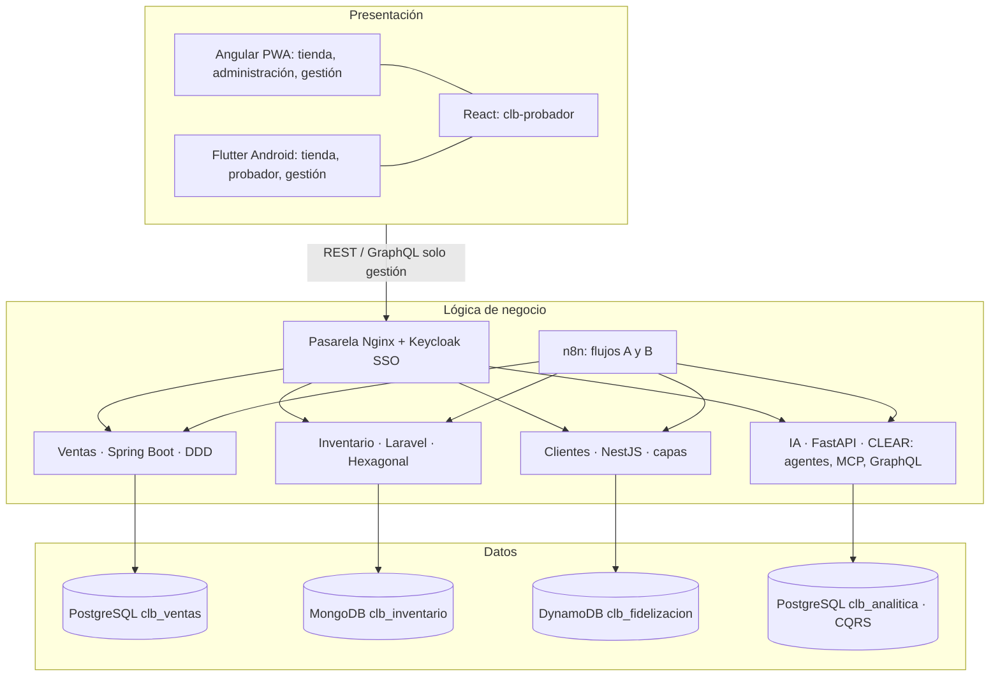

# R17 — Arquitectura de CLB Store

Versión documental: 2026-10-27. Sistema local demostrable para Ingeniería de Software II, Grupo 5. Fecha de entrega: 10 de noviembre de 2026.

Este documento distingue **implementación existente**, **ampliación validada con fixtures sintéticos autorizados** y **límites de aceptación fotográfica real**. La carga se controla con un indicador del despliegue (desactivado por defecto y habilitado en la demostración local). Se demostró el flujo técnico y offline; no se afirma generalización perfecta a cualquier fotografía real. Esa ampliación no sustituye la pose y recomendación offline ya existentes. Véase `docs/probador.md`.

## Vista clásica en tres capas

Es la arquitectura «clásica» que el docente pidió además de los cuatro niveles. Cada capa solo conoce a la de abajo
mediante contratos: REST o GraphQL hacia los servicios y SQL o API nativa hacia las bases.

Cada microservicio repite internamente la separación con su propia arquitectura de código. Los clientes (web y Android)
también tienen capas: dominio, aplicación, adaptadores y presentación, o Presentation/Domain/Data.

## Índice de los cuatro niveles

- [Backend](backend.md): servicios, puertos, límites de responsabilidad, REST, SAGA y eventos.
- [Frontend](frontend.md): Angular, React, Flutter, composición y funcionamiento offline.
- [Datos](datos.md): propiedad privada, proyección CQRS, archivos y sincronización.
- [Despliegue](despliegue.md): contenedores, redes, persistencia y operación local.

Las arquitecturas de código son una dimensión adicional: Hexagonal en Inventario, DDD en Ventas, CLEAR en IA y capas clásicas en Clientes. No se sustituyen los cuatro niveles por una lista de frameworks.

## Decisiones y pertinencia

| Decisión | Problema resuelto | Costo/límite |
|---|---|---|
| Cuatro servicios y bases privadas | Aislar reglas y disponibilidad por dominio | Comunicación y consistencia distribuida |
| SAGA con idempotencia | Confirmar compra en tres servicios sin transacción global | Compensaciones y estados de revisión |
| Modelo analítico CQRS | Reportes frecuentes con datos repartidos | Consistencia eventual y fecha de actualización visible |
| React como Web Component | Integrar probador independiente en Angular | Contrato duplicado comprobado y despliegue propio |
| Inferencia en cliente | Pose sin conexión y privacidad de imágenes personales | Capacidad del dispositivo, sin simulación física |
| ONNX en servidor local solo durante ingesta | Preparar prendas una vez, evitando carga pesada en clientes | Requiere conexión al servidor para administrar imágenes |
| Mismo microfrontend React en Android (WebView) | RA 3D idéntica en web y móvil con un solo código y un contrato | ≈ 21 MB en la APK y un servidor local en loopback |
| Estándar de calidad en la ingesta | Evitar prendas que se deforman o no se pueden probar | Umbrales calibrados con el catálogo; avisos con aceptación explícita |

## Alcance verificable

No hay pagos bancarios, factura fiscal, simulación de tela ni promesa de ajuste físico. El modelo 3D de una prenda es una
aproximación deducida de su foto frontal para la RA. El comprobante xlsx es un comprobante de venta. Cloud futuro es una posibilidad de configuración; el despliegue evaluado es local, no depende de servicios públicos durante la ejecución.

Evidencias y pendientes: [estado vigente del probador](../probador.md), [ICONIX](../iconix/LEEME.md). Los resultados históricos no equivalen a pruebas ejecutadas sobre la versión final.
