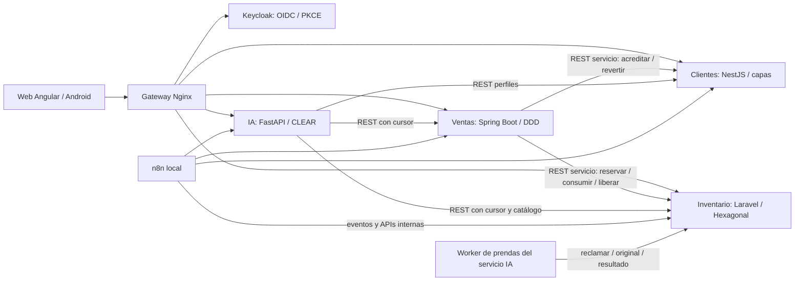
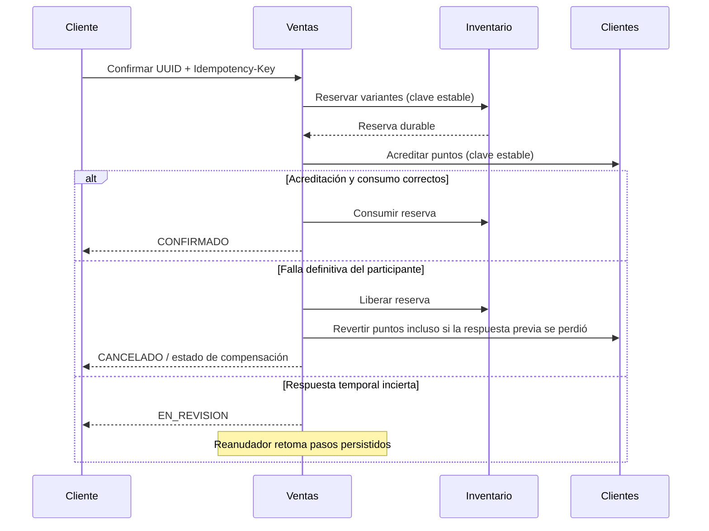

# R17 — Nivel backend

## Límites y comunicación



Gateway enruta; cada backend verifica firma JWT, emisor, audiencia y rol. Las rutas `/api/v1/interno/` no se publican. Keycloak es identidad, no propietario del catálogo ni de pedidos.

| Servicio | Reglas propias | Arquitectura y dependencias |
|---|---|---|
| Inventario | SKU, precio BOB, variantes, stock, reservas, recursos de prenda | Dominio y aplicación independientes; puertos de salida implementados por MongoDB/filesystem; adaptadores HTTP |
| Ventas | Pedido, total confirmado por servidor, SAGA y comprobante | Dominio sin Spring; aplicación orquesta mediante puertos; JDBC/HTTP en infraestructura |
| Clientes | Perfil por titular, fidelización y deduplicación | Presentación → negocio → datos; repositorios DynamoDB |
| IA | Especificación de reportes, gobierno de herramientas, tallas y procesamiento visual | Dominio/aplicación hacia adentro; FastAPI, GraphQL y MCP como puertos; ONNX, OpenCV, Ollama, STT y PostgreSQL en infraestructura |

GraphQL existe solo en gestión empresarial. Tienda, Android y comunicación entre servicios utilizan REST. MCP expone herramientas fijas y auditadas; el LLM no recibe SQL ni acceso directo a bases.

## R5 — Gestión empresarial sobre GraphQL (9-nov-2026)

Las interfaces de gestión (web y pestaña Gestión de Android, incluidos los procesadores de sus colas offline) usan un
único endpoint GraphQL, `POST /api/v1/graphql` del servicio IA, para sus **consultas y acciones de negocio**. La tienda
y la integración entre servicios siguen con REST. El esquema de los agentes (MCP) es otro esquema, solo de lectura.

| Área | Operaciones GraphQL | Propietario y delegación |
|---|---|---|
| Analítica | `resumenVentas`, `productos`, `stockBajo`, `alertas`, `segmentosClientes` | IA (modelo de lectura CQRS) |
| Reportes y agentes | `generarReporte`, `reportes`, `reporte`, `ejecutarMision`, `propuestas`, `resolverPropuesta`, `auditoria` | IA: mismos casos de uso que REST |
| Alertas de stock | `notificaciones`, `atenderNotificacion` | IA (creadas por el flujo n8n A) |
| Productos y variantes | `productosAdmin`, `productoAdmin`, `crearProducto`, `modificarProducto`, `variantesAdmin`, `varianteAdmin`, `crearVariante`, `modificarVariante` | Inventario |
| Stock | `registrarMovimiento`, `fijarMinimo`, `movimientos` | Inventario |
| Ingesta | `capacidadesIngesta`, `trabajoIngesta`, `publicarRecurso` | Inventario |

```mermaid
sequenceDiagram
  participant UI as Gestión web / Android (cola)
  participant G as GraphQL de gestión (IA)
  participant P as Puerto GestionInventario
  participant I as Inventario (REST propietario)
  UI->>G: mutation registrarMovimiento(variante, clave, datos{versión_esperada})
  G->>G: Rol admin; identificador y clave válidos
  G->>P: ejecutar(operación, JWT del admin)
  P->>I: POST /variantes/{id}/movimientos + Idempotency-Key
  alt Aceptado o repetición con la misma clave
    I-->>UI: {variante} (mismo cuerpo que REST)
  else Conflicto / validación
    I-->>UI: error con estado_http 409/422 y el cuerpo del propietario
  else Inventario sin respuesta
    G-->>UI: estado_http 503 → la cola reintenta con la misma clave
  end
```

- **Delegación sin reglas propias.** Para Inventario, IA solo valida la forma (rol admin, identificadores sin `/` ni
  `..`, clave de idempotencia, `datos` como objeto, límites de paginación) y llama al contrato REST interno de Inventario
  (`InventarioGestionRest`, lista cerrada de 14 operaciones) con el **JWT del administrador**, la `Idempotency-Key` y el
  cuerpo tal cual, incluida `versión_esperada`. SKU, CAS de versión, stock, deduplicación y estándar de calidad siguen
  en Inventario; IA no accede a MongoDB. Las respuestas de Inventario son el mismo cuerpo que con REST (escalar `JSON`).
- **Errores.** `extensions {codigo, estado_http, cuerpo?}`. Los clientes los convierten en el mismo error HTTP que ya
  clasificaban sus colas: 409/422/404 piden revisión y 5xx/429 se reintentan con la misma clave. 401/403 se responden en
  HTTP antes de ejecutar la operación.
- **Transferencia de archivos en REST (decisión técnica, no excepción del docente).** Audio a transcribir (`POST /voz`),
  carga de foto (`POST /productos/{id}/recursos-probador`) y descargas binarias (Excel, previsualización PNG) usan REST
  con el mismo JWT admin: GraphQL responde JSON y transportar binarios en base64 añade ~33 % y rompe la descarga nativa.
  La operación de negocio asociada sí va por GraphQL (consultar el trabajo, publicar, pedir el reporte).
- **Dependencia aceptada.** La administración de Inventario desde las interfaces de gestión depende de que el servicio
  IA esté disponible. Mientras IA no responde, las consultas muestran la copia guardada y las escrituras quedan en la
  cola offline y se reintentan con la misma clave; el catálogo público y la SAGA de compra no dependen de IA. La prueba
  con IA detenida está pendiente de autorización (`docker stop clb_backend_ia`).
- **Transición.** Las rutas REST equivalentes de IA e Inventario no se retiraron: siguen siendo contratos internos y
  las usan demos, sembradores, pruebas del propietario y Ventas. Las interfaces de gestión ya no las usan para
  operaciones de negocio.

## Compra distribuida



No hay rollback global. Las claves de pasos se conservan; una respuesta perdida no justifica repetir con otra identidad. Outbox y cambio del pedido se confirman juntos en PostgreSQL.

## R9 — La compra como transacción transversal (y por qué no se implementó la devolución)

El docente pidió una acción que involucre al menos tres microservicios sin rollback global y sugirió SAGA. Su ejemplo
fue una devolución. La **compra** cumple el mismo requisito con una SAGA real y probada con fallas:
Ventas orquesta → Inventario reserva → Clientes acredita → Inventario consume. Ante una falla definitiva se compensa:
se libera la reserva y se revierten los puntos.
- `demo-compra-saga.py` la demuestra deteniendo Clientes de verdad.
- Las claves de cada paso son fijas y el reanudador retoma las SAGA interrumpidas.

La devolución sería la SAGA inversa y reutilizaría piezas idempotentes que ya existen:
- Ventas registra la devolución de un pedido CONFIRMADO;
- Inventario hace la ENTRADA de las unidades;
- Clientes revierte los puntos con `reversas` (idempotente por pedido);
- si Clientes falla, Inventario compensa con una SALIDA.

Se dejó como extensión documentada (decisión del equipo, 27-oct). Repetiría el mismo patrón sin demostrar un concepto
nuevo, y el tiempo se priorizó en requisitos sin cubrir.

## Preparación visual (ampliación desactivada)

El administrador carga una fotografía de producto. Inventario conserva original privado y trabajo en el mismo documento. IA reclama con vencimiento, procesa y entrega resultado. El administrador revisa y publica mediante versión esperada. Este flujo administrativo no recibe fotos personales.

La publicación incrementa la versión comercial una sola vez. Una modificación simultánea, resultado tardío o clave con otros datos se rechaza. Las referencias publicadas por hash permanecen disponibles tras reemplazarlas. Fallar IA no cambia stock ni compras.

Un proceso worker adicional sigue perteneciendo al servicio IA: no publica API, no posee otra base y solo usa REST de Inventario. Concurrencia uno y proceso de inferencia terminable tras 60 s. No añadir ONNX a Laravel ni pasar credenciales MongoDB a IA.

## Preparación de material y estampados (actualización de implementación)

El adaptador de preparación IA CLEAR procesa fotografías de producto: U²-Net segmenta y un adaptador PP-OCRv4 ONNX local propone rectángulos de texto que deben conservarse. No reconoce ni genera letras. El worker inyecta ambos adaptadores y falla si faltan pesos precargados. Inventario Hexagonal valida método `u2net-perfiles-3`, anclas y hasta16 rectángulos; conserva propiedad de originales/resultados, CAS, arrendamiento e idempotencia. No se añade servicio público ni acceso a bases ajenas. Clientes en capas y Ventas DDD conservan sus contratos. Los modos locales procesan la foto personal exclusivamente en clientes. El modo generativo opcional la envía, con aviso previo, al worker CatVTON del mismo servicio IA; véase VTON.md.
