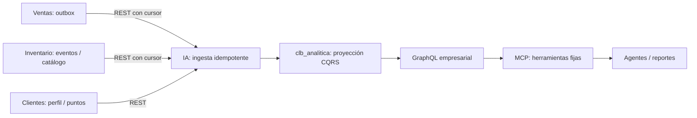

# R17 — Nivel de datos

| Propietario | Almacenamiento | Información | Acceso permitido |
|---|---|---|---|
| Inventario | MongoDB `clb_inventario` | Productos, variantes, stock, reservas, deduplicación, trabajos y referencias visuales | Solo Inventario |
| Inventario | Volumen `clb_recursos_prendas` | Originales privados, texturas, maestros y copias publicadas | Solo adaptador de Inventario; publicación servida mediante gateway/Nginx tras comprobar referencia |
| Ventas | PostgreSQL `clb_ventas` | Pedidos, líneas, pasos SAGA, outbox y comprobantes | Solo Ventas |
| Clientes | DynamoDB Local | Perfiles, puntos, acreditaciones/reversas y claves idempotentes | Solo Clientes |
| IA | PostgreSQL `clb_analitica` | Proyección analítica, cursores, reportes, propuestas y auditoría | Solo IA; usuario distinto de Ventas |
| IA (worker VTON opcional) | SQLite y PNG en `clb_resultados_vton` | Estado y resultado privado por contenido/titular/versión, TTL 24 h | JWT del titular; no almacena originales de personas |
| Cliente Web | IndexedDB | Catálogo, variantes, carrito, cola, metadatos y blobs | Mismo origen del navegador |
| Cliente Android | SQLite + archivos privados | Catálogo, variantes, carrito, cola, metadatos y texturas | Aplicación Android |
| Cliente Android (VTON) | SQLite `clb_vton_cola.db` y PNG privados | Originales pendientes, resultados y borrados por sincronizar; independientes de pedidos | Cuenta titular; originales retirados al completar/eliminar |
| Cliente Web (VTON) | Cache Storage y marcas en localStorage | Hasta 20 resultados e invalidación remota pendiente por cuenta | Mismo origen y titular comprobado por adaptador |

## Consistencia y proyección transversal

CQRS evita consultar tres bases ajenas para cada reporte. Lote y cursor se confirman juntos; eventos repetidos no duplican agregados. La información es eventualmente consistente y se muestra su fecha. n8n no alimenta la proyección como dependencia obligatoria.

MongoDB permanece standalone: producto y comprobante administrativo en una escritura; existencias y reservas dentro de su agregado. La mejora usa revisión CAS del flujo y versión comercial en la misma actualización. No se introduce una transacción multidocumento implícita.

## Archivos y activación offline

Los PNG no se incrustan en documentos MongoDB. Se escriben completos y verifican antes de publicar referencias. MongoDB y filesystem no comparten transacción: un archivo huérfano es recuperable; una referencia a bytes incompletos no debe activarse.

En Web, descargas y SHA-256 se completan antes de una transacción IndexedDB que activa productos y blobs. En Android se confirman archivos por renombrado y después catálogo/manifiesto en SQLite. Un corte conserva el catálogo anterior; los archivos extra no alteran su estado comercial. SQLite v2 añade metadatos visuales a v1 sin borrar carrito ni cola.

Las rutas públicas solo contienen un hash validado; conocer un hash de previsualización no habilita su lectura pública. Los originales son accesibles solo por un reclamo interno vigente. Se conserva historial publicado para no invalidar URLs inmutables.

## Recursos 3D, calidad y preferencias (27-oct)

- Inventario guarda en el recurso esquema 2 `modelo3d` (números normalizados, contrato cerrado), `espalda` (otra textura
  verificada por hash) y `calidad` (informe de la ingesta). Una foto `no_apta` nunca queda lista ni se publica.
- Web (IndexedDB) y Android (archivos por hash) descargan la espalda junto con la textura frontal. Un paquete incompleto no
  reemplaza al anterior, así que la RA funciona sin red.
- Android guarda en `metadatos` sus preferencias de dispositivo: modo del probador y rendimiento medido de la RA.
- n8n guarda sus cursores y la lista acotada de eventos rechazados en los datos estáticos de cada flujo (M03).

## Modelo conceptual

Producto 1—N Variante; Variante tiene talla/color/SKU y existencias. Pedido contiene N líneas con copia de precio/categoría/talla/color para conservar historia. Una reserva enlaza pedido con cantidades de variantes. Perfil y fidelización identifican al titular por `sub`. Un producto tiene N trabajos visuales y una referencia visual vigente; cada recurso representa un color concreto.

Los modos locales no almacenan fotos personales ni derivan medidas físicas de coordenadas 2D. En el modo generativo, Android conserva originales pendientes en su SQLite privado y los elimina al terminar o retirar la solicitud; el servidor conserva solo resultados hasta 24 horas. Los datos de prueba se aíslan en colecciones/esquemas temporales; nunca se borran volúmenes para probar persistencia.

## Metadatos de protección de estampados

El bloque opcional `anclas.estampados` contiene hasta16 cajas normalizadas `[x0,y0,x1,y1]` referidas al PNG final. Método3 exige el campo; `[]` indica análisis ejecutado sin texto detectado. No garantiza ausencia de símbolos o bordado indetectable. Contrato aditivo, sin migración Mongo/SQLite/IndexedDB; los clientes preservan el JSON y verifican el hash del binario. Una prenda antigua sigue siendo válida, aunque no active el nuevo material hasta prepararse de nuevo.

El atlas384², máscara semántica, campo de luz y composición son valores efímeros del cliente. Este modo local no persiste ni transmite la fotografía personal. El modo CatVTON tiene consentimiento, cola y retención específicos descritos en VTON.md. Original del producto privado y derivados inmutables mantienen la propiedad de Inventario. Publicación anterior y paquete offline completo se conservan para rollback; no se borran volúmenes ni se modifica stock.
