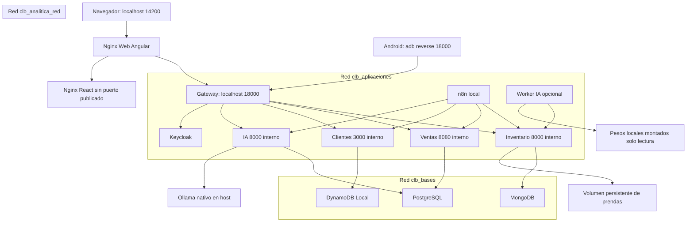

# R17 — Nivel de despliegue

Fuente operativa: `infraestructura/bases-de-datos/compose.yaml`. Proyecto Compose `clb-store`. Todos los accesos publicados se enlazan a 127.0.0.1.

IA no está en la red de MongoDB/DynamoDB; Ventas e Inventario no leen `clb_analitica`. El worker visual solo necesita la red de aplicaciones, sin base propia ni puerto. PostgreSQL comparte motor físico, pero Ventas e IA tienen bases/usuarios distintos.

## Preparación y operación

1. Mantener secretos exclusivamente en `.env` local. `docker compose config --quiet` valida configuración sin imprimirlos.
2. Preparar imágenes, dependencias y pesos mientras haya Internet; esa preparación no equivale a ejecución offline.
3. `docker compose up -d --build --wait` levanta la plataforma preservando volúmenes.
4. La ingesta visual está apagada por defecto. Instrucciones y puertas de activación: `docs/probador.md` («Preparación de prendas»).
5. `docker compose stop ia-prendas` detiene solo procesamiento nuevo. La copia descargada del cliente funciona sin worker, backend o gateway.

La restricción de salida de red de la demostración se debe comprobar; las redes bridge de Compose por sí solas no constituyen un firewall contra Internet. No se corta la conexión pública del host de forma automática durante esta sesión.

## Cambios del 27-oct

- n8n: `EXECUTIONS_DATA_PRUNE=true` y `EXECUTIONS_DATA_MAX_AGE=24`. Los flujos no guardan datos de ejecuciones exitosas
  (M04).
- Android: la APK incluye el probador React y BlazePose (≈ 21 MB) y abre un servidor HTTP solo en loopback mientras se usa
  la RA. No publica puertos hacia la red.
- Demostración de tolerancia: `demo-apagar-ia.py` detiene `clb_backend_ia` y comprueba catálogo, compra SAGA y la
  reanudación por cursor.

## Persistencia y fallo

Volúmenes de ventas, inventario, configuración MongoDB, clientes, identidad, modelos IA, n8n y recursos de prendas sobreviven a recreaciones. No ejecutar `down -v`. El worker tiene filesystem de solo lectura, tmpfs, capacidades retiradas, 2 CPU y 2 GiB como límites iniciales; el modelo se verifica por hash antes de reclamar trabajos.

La validación offline de Android exige modo avión y retirar `adb reverse`; de otro modo el USB puede seguir dando acceso a la laptop. La cámara Web requiere localhost o HTTPS. Los datos OIDC y el emisor deben permanecer coherentes entre aplicaciones.

Cloud futuro se describe como migración de adaptadores/configuración, no como dependencia de esta entrega: PostgreSQL gestionado, MongoDB Atlas, DynamoDB y almacenamiento de objetos. No está desplegado ni se usa para el probador offline.

## Modelos de material y preparación

Aprovisionar U²-Net y `python microservicios/inteligencia-artificial/preparar-modelo-estampados.py` antes de habilitar el perfil prendas. El segundo script descarga solo durante preparación y verifica paquete/modelo. El worker monta `/modelos-prendas:ro`, CPU2, memoria2GiB, sin backend remoto ni descarga de emergencia. Procedencia en [detector](../../compartido/modelos/texto-prenda.md).

APK empaqueta SelfieMulticlass TFLite (~16.4MB); el microfrontend empaqueta descriptor y constantes TF.js de la misma red. Docker y adaptadores comprueban integridad. El Service Worker precarga estos archivos junto a MoveNet; no basta descargar catálogo. Inferencia personal sin red/API. HTTPS o localhost para cámara Web. Prueba física exige retirar reverse API y activar modo avión/Wi-Fi apagado; restaurar APK normal y ajustes al terminar. La versión y el resultado efectivamente instalados se registran en la bitácora, nunca se deducen del pubspec.

## Perfil VTON opcional

El worker `ia-vton` pertenece a IA, se habilita con perfil Compose `vton` y comparte
la pasarela existente. Usa GPU NVIDIA, pesos locales de solo lectura y un volumen privado
de resultados; no publica puerto adicional ni pertenece a redes de bases ajenas.
Un proceso hijo precargado posee la GPU; HTTP no acepta trabajo hasta que esté listo.
La salud comprueba su supervivencia. Arranque admite hasta 300 s para verificación/carga;
la inferencia tiene plazo separado de 600 s y no inicia un proceso nuevo por solicitud normal.
El catálogo no depende de este perfil. Instrucciones y evidencias en
[microservicio IA](../../microservicios/inteligencia-artificial/VTON.md).
