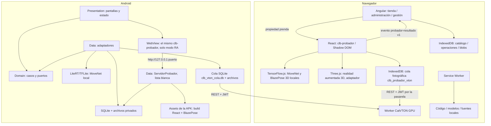

# R17 — Nivel frontend

Angular y React se organizan por funcionalidad en dominio/aplicación/adaptadores/presentación. Angular no depende de React ni TensorFlow.js; el probador no conoce Angular ni la implementación de OIDC. En el modo generativo recibe un puerto de sesión que entrega titular/cabeceras, sin importar el SDK de identidad. Flutter tiene Presentation, Domain y Data; `main.dart` compone implementaciones.

## Inteligencia de negocios (Dash, `/bi/`)

Cuarto frontend, en Python (Dash/Plotly) y solo web: `dominio/aplicacion/adaptadores/presentacion`. Se abre desde Gestión
en otra pestaña, en el mismo origen; la web nginx lo remite a la pasarela y el Service Worker excluye `/bi/**`. SSO
propio con Keycloak (`clb-bi`, Authlib) y tokens solo en el servidor. Consume únicamente el GraphQL de gestión
(`indicadoresDemostracion`, `generarReporte`) y el modelo de tallas público. Guía: `aplicaciones/inteligencia-negocios/LEEME.md`.

## Contrato e interacción

- `<clb-probador>` recibe `prenda`: identidad, SKU, nombre, categoría, imagen y tallas. La extensión opcional `recurso` añade color y anclas de textura; `catalogo` (opcional) ofrece prendas para combinar arriba y abajo.
- `probador-resultado` conserva `contrato: 1`, se emite una vez por prenda del conjunto y no entrega imagen ni medidas personales al shell.
- `precargar()` y el manifiesto permiten preparar código/modelos sin ejecutar cámara al arrancar.
- Web soporta foto y cámara con descarte de resultados tardíos y cierre de pistas al salir/ocultar. Android tiene
  cámara en vivo en la RA 3D (WebView) y foto de cámara o galería en la vista rápida y la foto con IA.
- Propiedades opcionales del contrato v1: `modos` (el anfitrión limita los modos; Android pide solo `ra`) y el evento
  `probador-rendimiento` (img/s medidas por la RA en ese dispositivo, una vez por sesión de cámara).
- Las texturas dinámicas se usan solo tras verificación y persistencia; productos anteriores conservan imágenes y ajuste heredados.
- El color representado se informa explícitamente. No se aplica recoloración automática ni se certifica caída de tela.
- El probador sigue tres pasos: elegir prendas (ranuras «Arriba» y «Abajo»; un vestido ocupa ambas), elegir cómo
  probarse y probarse con la talla por prenda. Ruta `/probador` en la navegación y `/productos/:id/probador` desde la ficha.
- Modos: realidad aumentada 3D (BlazePose TF.js + Three.js en el dispositivo; la geometría y la medición del cuerpo son
  dominio puro, `dominio/ra/`), fotografía con IA (CatVTON en el servidor GPU; un conjunto se genera en dos pasadas
  encadenadas por la cola) y vista rápida 2D (MoveNet TF.js/TFLite, offline). La fotografía con IA se pide offline: la
  foto se guarda en el dispositivo y la cola la envía al volver la conexión, con la misma clave de idempotencia por
  titular, foto, prenda, categoría y versión del motor. La «vista 3D frontal» local se retiró el 26 de octubre: la RA la
  reemplaza.
- La geometría de mangas (`prenda-articulada`) es igual en TypeScript y Dart: ambas pruebas comparan con
  `compartido/prendas/fixtures/regiones-resultado.json` (manga corta y larga).

## Android: el mismo microfrontend en una WebView

La RA 3D del móvil no se reescribió: Android aloja el mismo `<clb-probador>` en una WebView. Esa reutilización entre dos
shells, Angular y Flutter, con un mismo contrato es justamente el propósito de un microfrontend.
- `ServidorProbador` (Data) sirve desde `127.0.0.1` y con puerto efímero el build React, BlazePose y las texturas ya
  descargadas. `localhost` es un contexto seguro, necesario para la cámara y los módulos ES. Lista blanca de rutas, CSP de
  la web y ninguna petición externa (verificado en modo avión).
- `preparar-probador.ps1` copia el build y los pesos a `assets/probador/` y verifica `modelos-blazepose.sha256`.
- La vista rápida (MoveNet TFLite) y la foto con IA (cola SQLite) siguen nativas: R7/R11 en el móvil se cumplen con
  TensorFlow Lite.
- La cámara se apaga al cambiar de modo, al salir o al pasar a segundo plano (`clbPausar` desmonta el componente).
  Verificado con `dumpsys media.camera`.
- Rendimiento en un Galaxy S23: 8,6 img/s con `full` y 10,4 con `lite`, tras reducir a 640 px el cuadro de análisis.

## Android: administración y gestión (solo rol admin)

- Pestaña «Gestión»: resumen, misión de agentes, alertas, propuestas, reportes, existencias e ingesta. Desde el
  9-nov-2026 todas sus consultas y acciones de negocio, y los procesadores de la cola, usan el GraphQL de gestión
  (`consultarGestion` en `administracion_rest.dart`; en la web, `gestion-rest.ts` y `administracion-rest.ts`); solo el
  audio, la foto y las descargas viajan por REST. Un error trae `estado_http`, así la cola decide igual que antes.
  Usa la misma cuenta SSO; los servicios vuelven a validar el rol en el JWT.
- **Una sola cola** para pedidos y cambios de administración, procesadores por tipo y orden FIFO:
  - `versión_esperada` encadenada por variante;
  - «Rehacer» solo ante un conflicto definitivo;
  - «Reintentar» con la misma clave ante un resultado incierto.
- Lectura offline desde una copia con «Datos al». Las escrituras que no pueden esperar (confirmar una reposición, generar
  un reporte o preparar una foto) exigen conexión y lo explican.

## Offline y sesión

La disponibilidad requiere shell, microfrontend, modelo de pose, catálogo y texturas completos. JSON descargado por sí solo no basta. La cola de compras conserva UUID, titular e Idempotency-Key; sin red queda pendiente, no confirmada.

La aplicación puede consultar catálogo y probar prendas sin renovar sesión. No se permite iniciar una sesión nueva sin identidad disponible. Escrituras administrativas requieren conexión al servidor local y autorización comprobada por Inventario.

IndexedDB solicita persistencia donde esté disponible; cuota o borrado del navegador se reflejan como indisponibilidad, sin prometer almacenamiento indestructible. Android usa SQLite y archivos privados persistentes, no el directorio temporal.

El nuevo panel es una ampliación del diseño existente: fotografía → procesamiento → previsualización → publicación, con estados de espera, rechazo y error recuperable. La condición visual/CV y la comprobación en teléfono físico siguen sujetas a la bitácora.

## Extensión de regiones articuladas

La geometría pura de torso/mangas permanece en Domain y su referencia común vive en compartido/prendas/fixtures. Presentation lee alfa una vez, pinta con Canvas2D/Web o ImageShader/drawVertices en Flutter y libera recursos. MoveNet conserva TF.js/LiteRT local; sus codos orientan mangas, sin añadir inferencia en servidor. Contratos y persistencia offline no cambian. El borde superior se ancla `SOBRE_HOMBROS` por encima de las articulaciones y `regionCuello` vuelve a dibujar el cuello original sobre la prenda (mismo cálculo en TS y Dart). Diseño, fallback y evidencia en [docs/probador.md](../probador.md).

## Transferencia de material sobre camiseta base

Para Poleras con `anclas.estampados` analizado se ofrece un modo de fotografía local, seleccionado antes del visor. MoveNet proporciona hombros/cadera; SelfieMulticlass de seis clases delimita ropa y protege piel/cabello. Un compositor puro TS/Dart separa el borde del pantalón y los objetos detectables, transfiere el tejido y conserva iluminación de la camiseta base. Los estampados protegidos conservan los píxeles originales con escala uniforme, sin estirar letras según el largo del torso. El corte continúa siendo el de la camiseta base; no se predice talla física ni se reconstruye ropa oculta.

React usa el puerto SegmentadorTejido y un adaptador TensorFlow.js. Android define CompositorCamiseta en Domain y lo implementa en Data mediante LiteRT/Isolate, inyectado desde main. Modelos verificados por SHA-256, recursos liberados y un trabajo activo; sin inferencia semántica continua. Cámara Web conserva regiones articuladas. Desmarcar el modo vuelve explícitamente a esa superposición; un rechazo de material nunca la activa silenciosamente. Confianza de pose y estado de composición son mensajes distintos. Alcance, evidencias y pendientes en [docs/probador.md](../probador.md).
