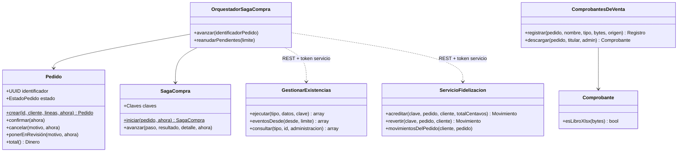
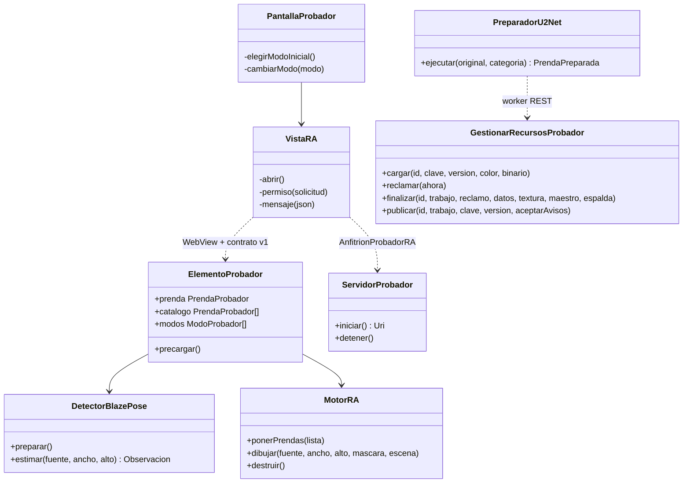
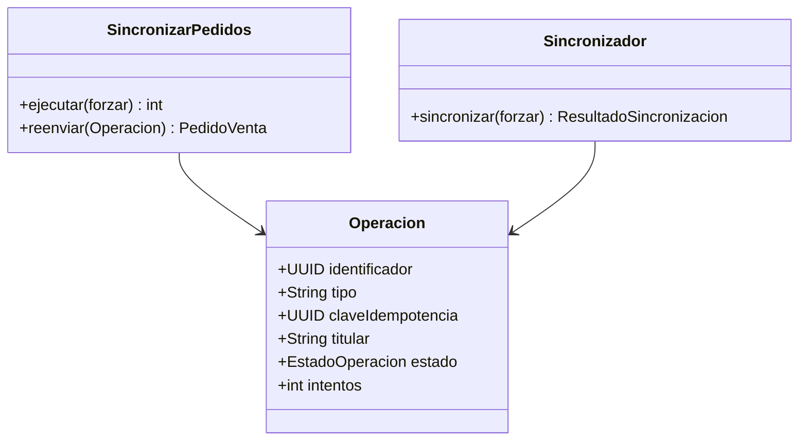

# Diagrama de clases de diseño

ICONIX lo deriva de las secuencias: aquí aparecen las clases que realizan los casos, con sus operaciones. El modelo de
dominio (`modelo-dominio.md`) queda como vista conceptual. Las operaciones son las del código. En Inventario,
`GestionarExistencias.ejecutar` despacha por `tipo` (RESERVAR, CONSUMIR, LIBERAR, REGISTRAR_MOVIMIENTO…) en una sola
escritura condicional del agregado.

## Compra distribuida (CU03) — Ventas (DDD), Inventario (Hexagonal), Clientes (capas)

## Probador (CU02.x) — web, Android e IA

## Sincronización offline (CU03, CU04) — colas con idempotencia

