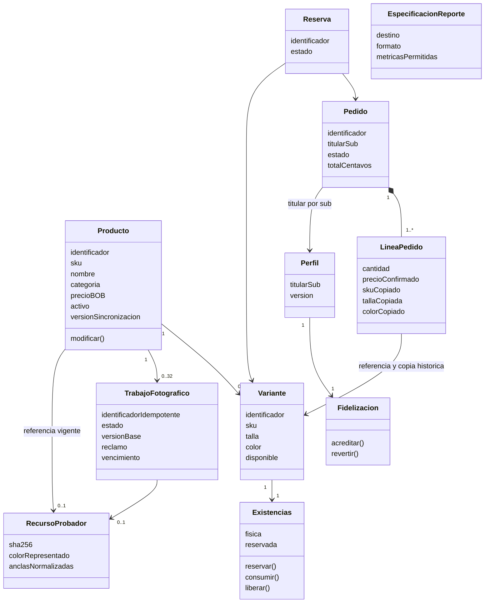

# Modelo de dominio y clases

## Invariantes

- Dinero en centavos enteros; precio REST decimal en texto BOB. El cliente no confirma precios finales.
- Disponible = física − reservada; no permitir existencias negativas ni consumir dos veces una reserva.
- Identidad de pedido, operación y claves de pasos se conserva entre reintentos.
- Pedido pertenece al `sub` validado; un cliente no elige otro titular en el cuerpo.
- La reversa de fidelización es idempotente incluso si precede a una acreditación tardía.
- La publicación visual exige trabajo LISTO, revisión vigente y versión comercial esperada. Un resultado sustituido no altera la referencia publicada.
- El recurso describe una vista frontal y un color, sin certificar ajuste físico. Las anclas se refieren a la textura recortada.
- Los reportes usan métricas permitidas sobre datos reales; el texto del LLM no es fuente de cifras.

## Realización por arquitectura

| Concepto / colaboración | Implementación |
|---|---|
| Producto, CodigoSku, PrecioEnBolivianos | Dominio de Inventario; reglas puras |
| RegistrarProducto, ModificarProducto, GestionarExistencias | Aplicación de Inventario con puertos |
| GestionarRecursosProbador / RecursoProbador | Aplicación y dominio visual en Inventario; repositorio CAS y archivos como adaptadores |
| Pedido y OrquestadorSagaCompra | Dominio/aplicación de Ventas; infraestructura JDBC y clientes HTTP |
| Perfil y puntos | Módulos NestJS con presentación, negocio y datos |
| PrepararPrenda / PreparadorFotografico | Caso de uso y puerto CLEAR; ONNX/OpenCV en infraestructura |
| ProbarPrenda | Casos de uso locales React/Flutter; pose y transformación sin red |
| EspecificacionReporte y GobiernoHerramientas | Dominio/aplicación IA; GraphQL/MCP e infraestructura externa al núcleo |

Las asociaciones entre servicios son referencias o mensajes, no claves foráneas entre sus bases. Los nombres sin tildes en los diagramas facilitan interoperabilidad del renderer; el código conserva identificadores españoles existentes.

## Realización del material y protección de diseño

`SegmentadorTejido` (aplicación React) y `CompositorCamiseta` (dominio Android) separan inferencia/adaptadores de la composición pura. `Material`, `CampoCamiseta` y raster son valores efímeros sin identidad comercial. `anclas.estampados` es metadato del recurso comercial validado por Inventario; el adaptador `DetectorEstampadosLocal` de IA lo propone y conserva píxeles originales. No añade entidades a Ventas/Clientes ni relaciones entre sus bases. La confianza de pose no es probabilidad de ajuste físico.
