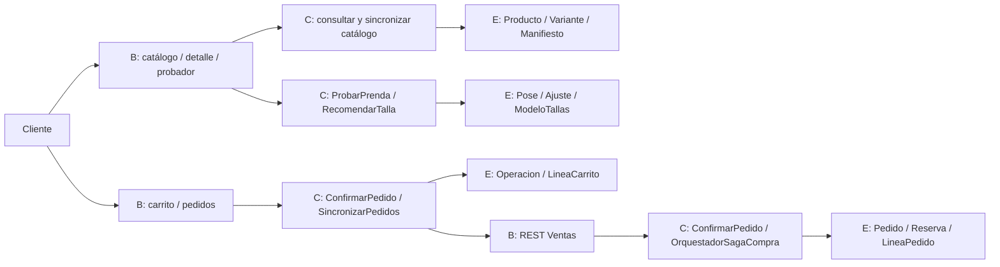
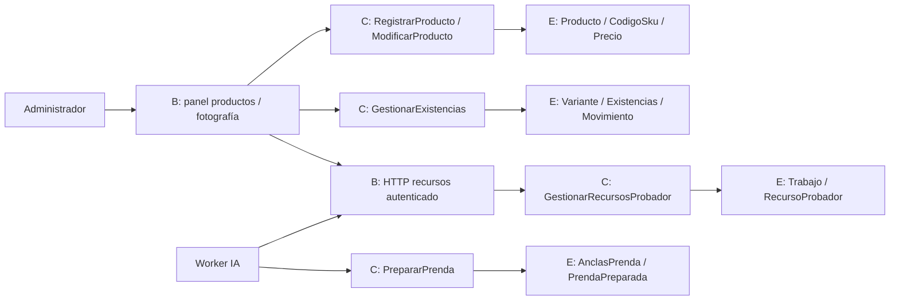
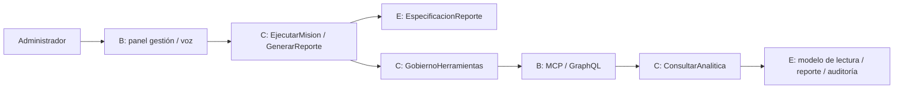
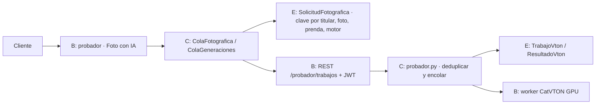
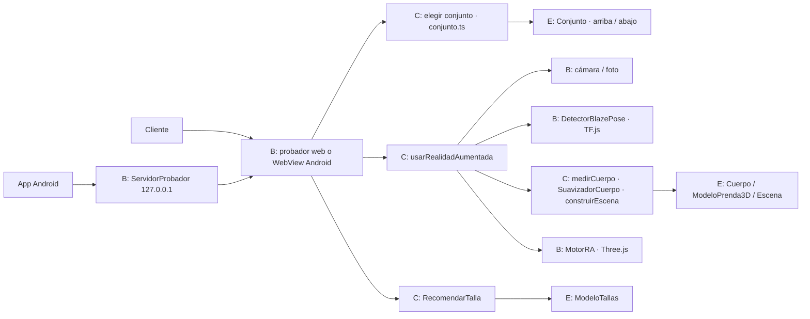
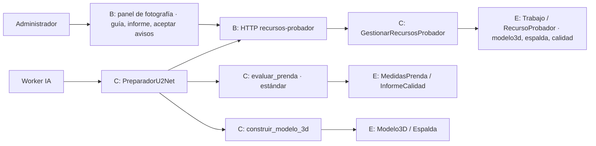
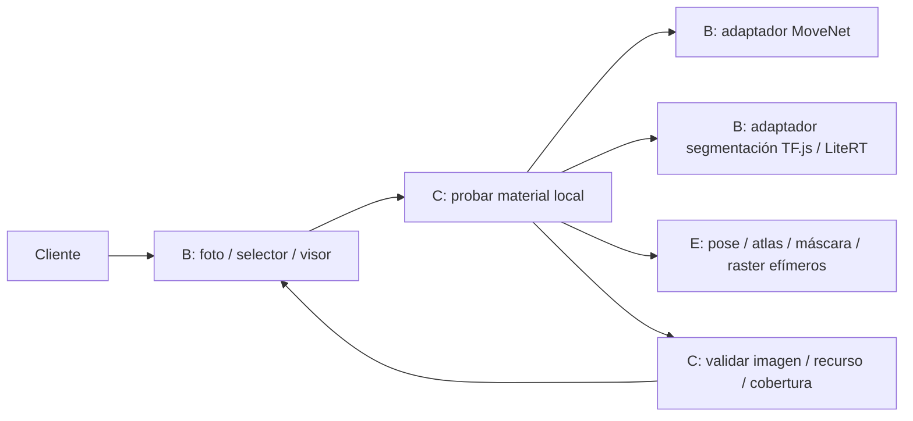
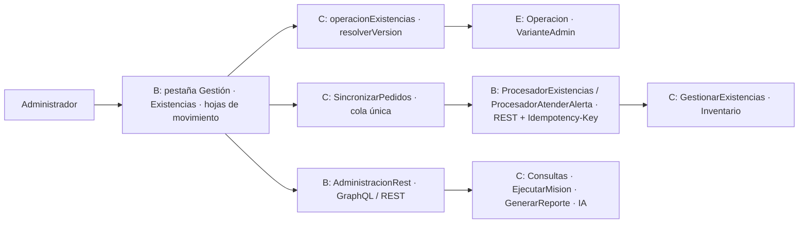

# Análisis de robustez

Convención: B = boundary/interfaz, C = control/caso de uso, E = entidad. Los actores hablan con interfaces; las interfaces delegan en controles. Los repositorios/adaptadores realizan persistencia y no sustituyen las reglas de dominio.

| Caso | Interfaces | Controles | Entidades y alternativos clave |
|---|---|---|---|
| CU01 | Sesión OIDC, retorno, perfil REST | iniciar/cerrar sesión, editar perfil | Titular/Perfil; estado PKCE inválido, token vencido, conflicto |
| CU02 | catálogo, detalle, cámara | sincronizar, probar, recomendar | Producto/Variante/Pose/Ajuste; descarga parcial y puntos insuficientes |
| CU03 | carrito, pedidos, REST internos | confirmar, SAGA, reanudador | Operación/Pedido/Reserva; compensaciones y repetición |
| CU04 | panel, HTTP admin | registrar/modificar/existencias | Producto/Variante/Movimiento; conflicto y rechazo |
| CU04.9 | carga, preview, REST worker | gestionar/preparar/publicar recurso | Trabajo/Recurso/Anclas; sustitución, timeout y geometría ambigua |
| CU05 | gestión, voz, MCP y GraphQL | misión/reporte/gobierno/consulta | Especificación/Reporte/Auditoría; inyección, concurrencia y datos antiguos |

La cámara y ONNX son adaptadores técnicos. No se los dibuja como entidades comerciales. El análisis no habilita llamadas directas de una pantalla a MongoDB o DynamoDB.

## CU02.1 — Fotografía generativa

## CU02.2 y CU02.3 — Conjunto y realidad aumentada 3D

## CU04.9 — Ingesta con estándar de calidad

## CU02 — Material fotográfico

Atlas y máscara son objetos técnicos efímeros, no nuevos agregados comerciales. Los rechazos se muestran en la misma interfaz y no generan pedidos, reservas ni escrituras en Inventario. El detector ONNX de zonas de texto pertenece al límite de preparación de producto, nunca al flujo de foto personal.

## CU04.10 y CU05.1 — Administración y gestión en el móvil

