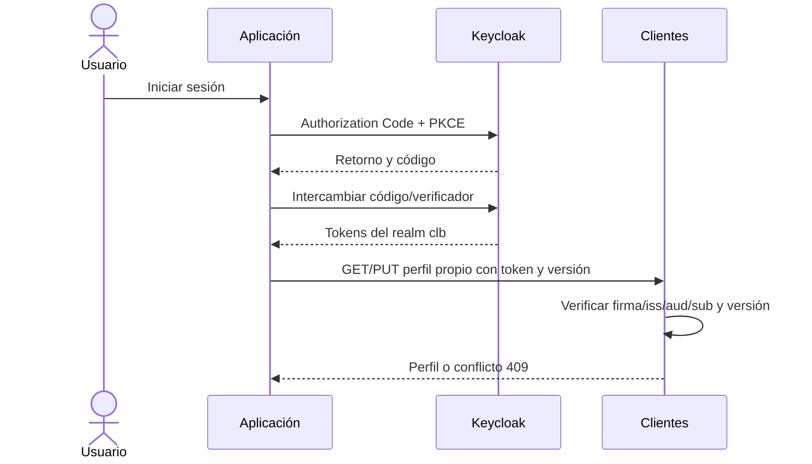
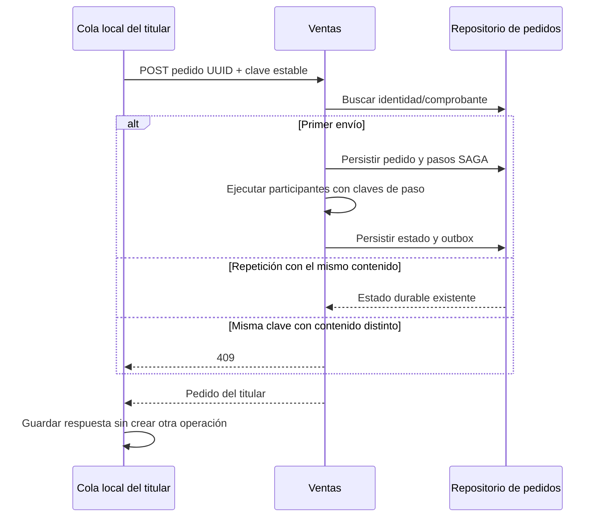
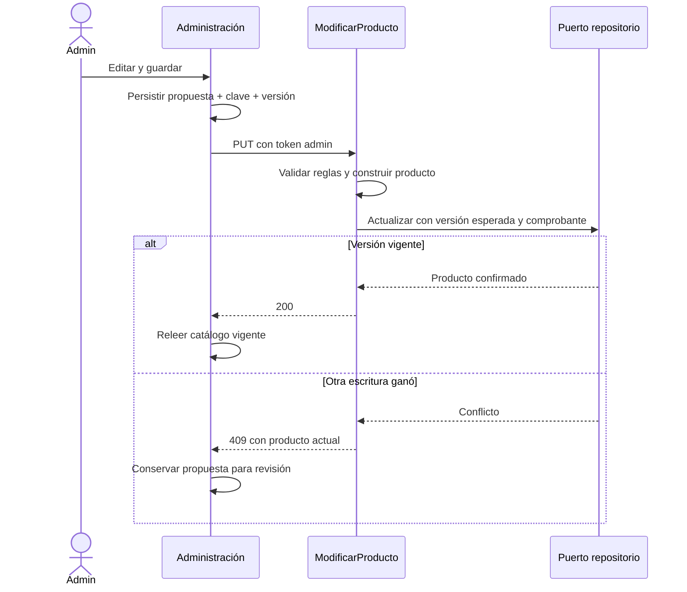
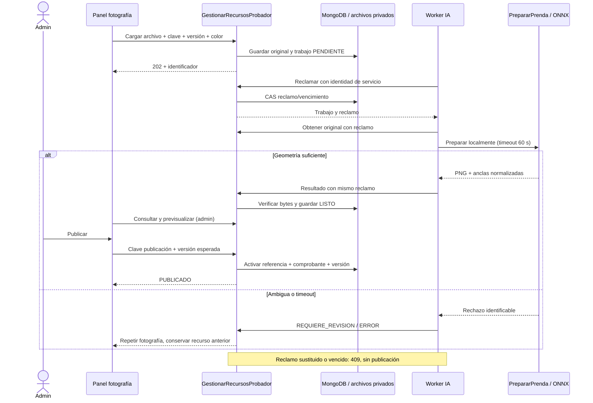
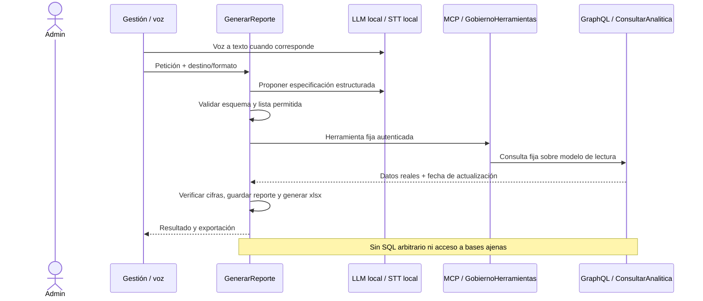
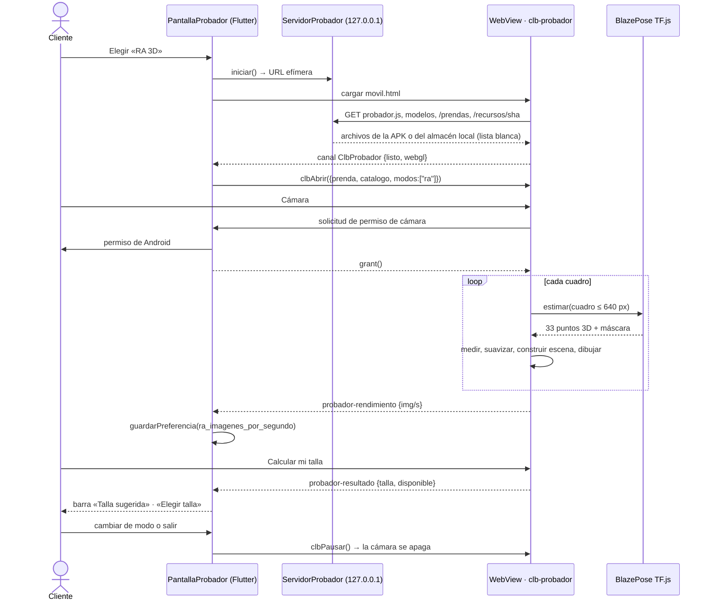

# Diseño de secuencias

## CU01 — Identidad y perfil



## CU02 — Paquete y prueba offline

```mermaid
sequenceDiagram
  actor U as Cliente
  participant UI as Web / Android
  participant S as Sincronización
  participant I as Inventario
  participant L as Persistencia local
  participant P as ProbarPrenda
  participant M as MoveNet local
  participant G as Geometría local de regiones
  S->>I: Catálogo y recursos publicados
  I-->>S: Manifiesto + PNG
  S->>S: Validar contrato/tamaño/SHA-256
  S->>L: Activar generación completa
  Note over UI,L: Desconectar red y reiniciar aplicación
  U->>UI: Probar prenda con foto
  UI->>L: Leer textura y modelo local
  UI->>P: Imagen local + anclas
  P->>M: Inferir articulaciones
  M-->>P: Pose
  P-->>UI: Pose + ajuste base / motivo insuficiente
  UI->>G: Alfa preparado + anclas + pose local
  G-->>UI: Malla torso/mangas o fallback seguro
  UI->>UI: Dibujar textura local o fallback; explicar ajuste parcial
  Note over P,M: Sin llamada al servidor
```

## CU03 — Compra, repetición y compensación

La secuencia transversal está en [arquitectura backend](../arquitectura/backend.md). Detalle de reintento:



## CU04 — Modificación optimista



## CU04.9 — Recurso fotográfico



## CU05 — Reporte verificable



## CU02 — Alternativa de material preparado (realización actual)

```mermaid
sequenceDiagram
  actor U as Cliente
  participant UI as React / Flutter
  participant L as Paquete local verificado
  participant P as MoveNet local
  participant S as Segmentador local TF.js / LiteRT
  participant C as Compositor puro TS / Dart
  U->>UI: Seleccionar modo material y foto frontal
  UI->>L: Leer textura, anclas y modelos
  UI->>P: Estimar hombros y cadera
  P-->>UI: Pose y confianza
  UI->>S: Segmentar foto en memoria
  S-->>UI: Probabilidades de seis clases
  UI->>C: Foto, pose, probabilidades y atlas con estampados
  alt Información suficiente
    C->>C: Máscara, oclusiones, borde y luz de camiseta base
    C-->>UI: Raster compuesto
    UI-->>U: Resultado y límites del corte base
  else Foto o recurso insuficiente
    C-->>UI: Motivo verificable
    UI-->>U: Repetir foto o preparar recurso; sin cambio silencioso de modo
  end
  Note over UI,C: Modo material local: sin API ni persistencia de fotografía personal
```

En CU04.9, el worker prepara segmentación/anclas y ejecuta detección de zonas de texto con ONNX local antes de entregar método3 a Inventario. No realiza reconocimiento ni síntesis de letras. Inventario valida las cajas, guarda archivos y publica mediante la misma escritura CAS/idempotente. Los diagramas de compra y SAGA no cambian.

## CU02.1 — Generación y eliminación de fotografía

```mermaid
sequenceDiagram
  participant U as Cliente
  participant C as Web o Android
  participant G as Pasarela
  participant V as Worker VTON del servicio IA
  participant M as Motor residente CUDA
  U->>C: Seleccionar foto y Generar (aviso previo)
  opt Android
    C->>C: Confirmar originales y solicitud en SQLite
  end
  C->>G: POST multipart + JWT
  G->>V: Validar titular, límites y contenido
  V-->>C: 202, identificador y estado
  V->>M: Inpainting con pesos locales y máscara protegida
  M-->>V: PNG completo
  V->>V: Publicar si sigue vigente la generación
  C->>G: Consultar estado e imagen con JWT
  G->>V: Leer resultado propio
  V-->>C: PNG, Cache-Control no-store
  C->>C: Guardar resultado; Android retira originales
  U->>C: Borrar / eliminar
  C->>C: Retirar vista, PNG y solicitud; persistir borrado pendiente
  C->>G: DELETE con JWT al conectar
  G->>V: Eliminar por titular
  V->>V: Retirar fila y PNG; invalidar publicación tardía
  V-->>C: 204
```

## CU02.3 — Realidad aumentada en Android (microfrontend en WebView)



## CU04.9 — Ingesta con estándar de calidad

```mermaid
sequenceDiagram
  actor A as Administrador
  participant I as Inventario
  participant W as Worker IA
  A->>I: POST foto + color + versión (Idempotency-Key)
  W->>I: reclamar (token servicio)
  W->>W: fondo → 768×1024 → modelo 3D + espalda → medir → evaluar_prenda
  alt no apta
    W->>I: REQUIERE_REVISION + calidad (motivos)
    I-->>A: informe con bloqueos
  else apta o con avisos
    W->>I: LISTO + textura + espalda + modelo3d + calidad
    I->>I: validar contratos; rechazar si calidad = no_apta
    A->>I: publicar (aceptar_avisos si hay avisos)
    I-->>A: PUBLICADO, versión + 1
  end

## CU04.10 — Movimiento de stock sin red y reconexión

```mermaid
sequenceDiagram
  actor A as Administrador
  participant P as PantallaVariantesAdmin
  participant Q as Cola SQLite (operaciones)
  participant S as SincronizarPedidos
  participant X as ProcesadorExistencias
  participant I as Inventario
  A->>P: Entrada +2, motivo
  P->>Q: encolarOperacion(UUID, clave, versión_esperada)
  S->>X: enviar (sin red)
  X-->>S: SinConexion
  S->>Q: PENDIENTE, intentos+1, próximo intento
  Note over A,I: vuelve la conexión
  S->>X: enviar(misma clave)
  X->>I: POST /variantes/{id}/movimientos (Idempotency-Key)
  I-->>X: variante versión+1
  X-->>S: comprobante validado
  S->>Q: CONFIRMADA + respuesta
```
