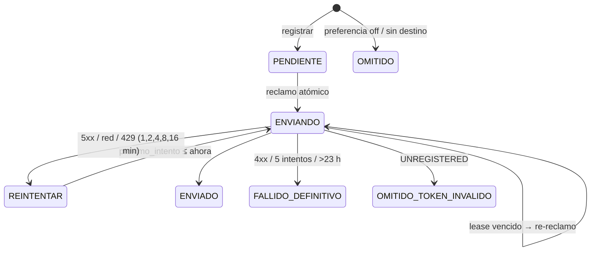
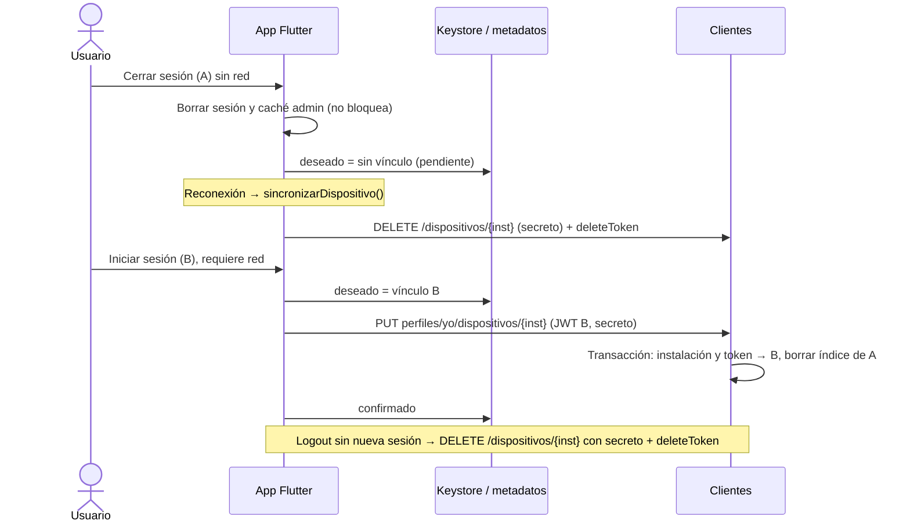
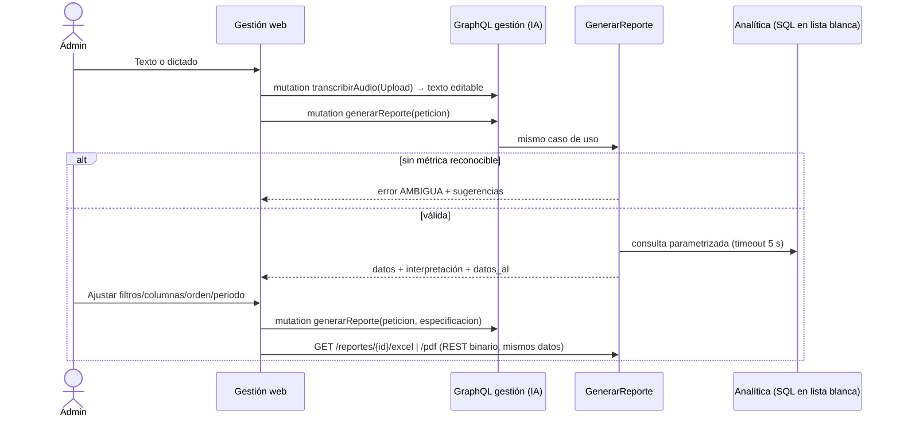

# Plan temporal de ejecución — Pulido final CLB Store (entrega 10-nov-2026)

## Contexto

Pulir CLB Store para la defensa de Ingeniería de Software II (grupo 5, ICONIX). **Hoy es 9-nov-2026: la entrega es mañana.**
Plan aprobado el 9-nov-2026. **Estado (9-nov):** F0, F1, F1b-I, F1b-II y F4 terminadas y verificadas (pendientes que requieren el S23 desbloqueado: aviso de sesión vencida y «Compartir PDF» en pantalla); F2 y F3 sin abrir, a la espera de decisión del usuario (requieren dispositivo desbloqueado y autorización de envíos reales). Detalle en `docs/estado.md`. Archivo temporal: se elimina al cierre según §«Cierre y eliminación del plan temporal». Progreso vivo en `contexto/progreso.md` (fuera del repositorio).
La rev. 2 incorpora tus seis ajustes:
- estado honesto por requisito;
- brecha GraphQL R5;
- recuperación de envíos;
- logout sin red;
- preferencias offline;
- arranque sin Firebase.

## Decisiones confirmadas
- **Orden:** F0 → F1 → **F1b-I → F1b-II (R5)** → F4 → F2/F3 si alcanza. **F5 (docs) va dentro de cada fase**, solo sobre lo comprobado.
  - F1b tiene prioridad sobre PDF, pulido visual y notificaciones.
  - Lo que no se termine se documenta como brecha abierta, no como cumplida.
- **R5 (ajuste del 9-nov):** GraphQL para las consultas y acciones de negocio de las interfaces de gestión; REST para la transferencia de audio y fotos y para las descargas; sin retirar endpoints ni migrar scripts (ver F1b).
- **Regla de corte:** F2/F3 no se abren si no hay margen para terminar **y verificar** el flujo completo. Una fase pospuesta se documenta en `docs/estado.md` como pendiente.
- **Al cerrar cada fase** el sistema queda demostrable: suites del componente en verde y una comprobación manual.
- **Preferencias por defecto:** Push y Correo activados (transaccionales). Push además requiere el permiso del sistema.
- **Correo:** API HTTPS de Resend con `Idempotency-Key`. Las variables SMTP del `.env` quedan sin uso y no se borran.
- **`google-services.json`:** ignorado en Git, con plugin condicional y documentación para obtenerlo.

---

## 0. Continuidad entre sesiones (primer paso tras la aprobación)
- Guardar este plan, versión definitiva, en **`CLB-STORE/docs/plan-pulido-final.md`**. Es la fuente del plan dentro del repositorio.
- **`contexto/progreso.md`** se reescribe como punto de continuación **breve**: enlaces al plan y a las fuentes vigentes (`AGENTS.md`, `docs/estado.md`, `docs/decisiones.md`), sin duplicar documentación.
- **Se actualiza tras cada bloque significativo** (p. ej. cada paso 1b.x), no solo al cerrar una fase. Contenido:
  - decisiones y alcance aprobados (un enlace a §Decisiones del plan);
  - fase actual y tareas terminadas, en curso y pendientes;
  - archivos modificados y su propósito;
  - pruebas **realmente ejecutadas**: comando, resultado y ubicación de la evidencia;
  - fallos, bloqueos y limitaciones;
  - cambios parciales todavía sin verificar;
  - siguiente paso concreto con sus comandos;
  - pruebas con efectos externos pendientes de autorización;
  - procesos dejados en ejecución, si los hay.
- **Nunca** secretos ni tokens. Sin commit ni push.
- **Al retomar en otra sesión:**
  1. leer `CLAUDE.md`, `AGENTS.md`, el plan y `contexto/progreso.md`;
  2. contrastarlos con `git status` y `git diff`;
  3. conservar los cambios existentes;
  4. no repetir tareas ya verificadas.

## 1. Diagnóstico

### Verificado en esta sesión (solo lectura)
- **Stack:** 12 contenedores *healthy*: ventas, inventario, clientes, ia, n8n (127.0.0.1:15678), angular (127.0.0.1:14200), probador, pasarela (18000), postgres, mongo, keycloak y dynamodb (sin healthcheck).
- **n8n 2.43.8:** recibe `CLB_FIREBASE_*`, `CLB_SMTP_*` y `CLB_RESEND_API_KEY`. Las 9 tienen valor en `.env`; no se imprimió ninguno. `N8N_BLOCK_ENV_ACCESS_IN_NODE=false`.
- **Cambios locales sin commit (Firebase):**
  - modificados: Gradle, Manifest (POST_NOTIFICATIONS), `pubspec.yaml` (firebase_core 5.1, firebase_messaging 17.0.1), `main.dart`, `compose.yaml`, `.env.example`;
  - sin rastrear: `google-services.json` y `lib/datos/servicio_notificaciones.dart`.
- **Pruebas Flutter, contadas sin ejecutar:** 24 archivos, 88 unitarias y 7 de integración.
- **APK:** del 27-oct, así que **no incluye Firebase**.
- **Grafo:** `CLB-STORE/graphify-out/GRAPH_REPORT.md` del 9-nov 00:27 está vigente. Se cruzó con lectura dirigida del código.

### Revisado en código, sin ejecutar
| Área | Estado real |
|---|---|
| SAGA compra | `OrquestadorSagaCompra.java`: RESERVAR→ACREDITAR→CONSUMIR→CONFIRMADO, compensaciones, 6 claves fijas, reanudador `@Scheduled`, outbox `eventos` en la misma transacción |
| n8n | 2 flujos (`generar-flujos.py`): stock bajo → alerta; pedido confirmado → comprobante (Ventas+Clientes+Inventario). Token Keycloak client credentials, cursor en *static data*, sin errorWorkflow |
| Reportes | Texto o voz (faster-whisper local) editable; Ollama `qwen3:8b` → especificación de esquema cerrado, con respaldo por palabras clave; SQL con lista blanca y parámetros enlazados; SVG y xlsx con antiinyección. **Faltan:** PDF, filtros, orden, rango, varias métricas, ambigüedad y `statement_timeout` |
| GraphQL (`puertos/graphql.py`) | **Solo `Query`, sin mutaciones:** `resumenVentas`, `productos`, `stockBajo`, `alertas`, `segmentosClientes` |
| Gestión por REST (web `gestion-rest.ts`, Android `administracion_rest.dart`) | `POST /agentes/misiones`, `POST/GET /reportes`, `GET /reportes/{id}`, `GET/POST /agentes/propuestas…`, `GET /notificaciones`, `POST …/atender`, `GET /agentes/auditoria`, `POST /voz`, `GET /reportes/{id}/excel` |
| Notificaciones | **No hay código que envíe correo ni push.** El token FCM solo va a `debugPrint`. Clientes no guarda correo, preferencias ni dispositivos; el correo solo está como claim `email` de Keycloak |
| Offline web | IndexedDB v4, cola única, Idempotency-Key, backoff ≤ 300 s, turno entre pestañas, REQUIERE_REVISION, aislamiento por `titular`, limpieza admin en logout |
| Offline Android | SQLite v2, cola única genérica (`tipo`+`datos`, `reemplazarOperacion`), `recuperarEnviando`, reintentos de 5–60 s, sincronización por red, temporizador y `alVolver`, aislamiento por `sub`, `_tokenDelTitular` |

### Evidencia histórica (27-oct, no re-ejecutada)
Flutter 87, web 69, probador 63, E2E 10/10, PWA aislada 5/5, Ventas 42, Clientes 21, pytest IA 73, PHPUnit 148/149, flujos 8+1, y pruebas físicas en S23 (RA offline, cola de stock, SSO app → Brave).

---

## 2. Discrepancias con el contexto reportado
1. **Fecha:** la entrega es mañana.
2. **«Firebase configurado»:** solo están la configuración y las dependencias. El adaptador:
   - hace `await` de `inicializar()` **antes de `runApp`** con `requestPermission` + `getToken()`, lo que puede bloquear el arranque sin red (riesgo R8);
   - pide el permiso sin contexto;
   - imprime el token;
   - no navega al tocar la notificación ni registra el token;
   - no está compilado.
3. **«Correo probado»:** ningún código del repositorio envía correo; si se probó, fue fuera de CLB Store. No es verificable sin enviar.
4. **«87 pruebas Flutter»:** dato del 27-oct, anterior a Firebase. `LEEME` dice 52 y el conteo estático da 88+7.
5. **Celular:** Windows ve el Samsung, pero `adb`/`flutter devices` no lo ven. **Falta activar o autorizar la depuración USB.**
6. **`google-services.json`:** no está ignorado y sin él no compila para el equipo.
7. **n8n:** con `N8N_BLOCK_ENV_ACCESS_IN_NODE=false`, la clave privada de Firebase y la contraseña SMTP son legibles desde cualquier nodo Code. Ningún flujo las usa.
8. **Clientes:** el comando de pruebas es `npm run probar`.
9. **R5:** las operaciones de gestión van mayormente por REST (sección 3 y F1b).

---

## 3. Estado por requisito (R1–R21)

Leyenda:
- **V** = verificado hoy;
- **C** = revisado en código sin ejecutar;
- **H** = evidencia histórica;
- **D** = solo documental;
- **P** = pendiente o brecha.

No se afirma cumplimiento total: varios requisitos dependen de evidencia histórica o tienen límites explícitos.

| R | Implementación | Evidencia | Límites / brecha | Acción |
|---|---|---|---|---|
| R1/R2 3+ servicios Spring/Nest/PHP | 4 servicios (+FastAPI) | V contenedores sanos · H suites | Suites sin re-ejecutar | F1: re-ejecutar |
| R3/R4 Angular+React microfrontend | Web Component `clb-probador` en el shell Angular y WebView Android | C · H 63, E2E 10/10 | React solo integra el probador (un microfrontend) | Explicarlo; sin cambio |
| **R5 GraphQL en gestión** | GraphQL solo con consultas de lectura | C | **P: misiones, reportes, propuestas, alertas y auditoría de gestión van por REST.** Se cumple «no en todo», pero la gestión no está construida sobre GraphQL | **F1b** |
| R6 Agentes | EjecutarMision, 4 agentes, misión «monitorea» | C · H S23 | Sin re-ejecutar; depende de Ollama | F1: demo de solo lectura |
| R7 IA local navegador/móvil | MoveNet/BlazePose TF.js, TFLite | H S23, Chrome | Cifras de una foto, no FPS de la WebView | — |
| R8 Offline+sync+idempotencia | IndexedDB/SQLite, colas, claves | C · H PWA 5/5, S23 modo avión | **P: riesgo nuevo de Firebase en el arranque**; aislamiento no re-ejecutado | F0 + F1 (web y Android) |
| R9 SAGA ≥3 servicios | Compra Ventas–Inventario–Clientes | C · H | Una corrida histórica falló sin log; devolución solo documentada | F1: demo **que muta datos**, con tu permiso |
| R10 ML sup./no sup. | Tallas (supervisado), K-Means | C · H fixtures | Tallas con datos sintéticos; **K-Means sin datos representativos**; no se fabrican | Documentar el límite |
| R11 DL TensorFlow imagen/video | MoveNet/BlazePose (TF.js/LiteRT) | H | Modelos preentrenados, solo inferencia; sin entrenamiento propio | Declararlo en la defensa |
| R12 Automatización encadenada | Comprobante: Ventas→Clientes→Inventario→Ventas | C · H 8+1 | Sin WhatsApp; comprobante ≠ factura fiscal | F2 la amplía (opcional) |
| R13 Reportes texto/voz, pantalla, export | STT local, especificación cerrada, SVG, xlsx | C · H | Faltan filtros, orden, rango, columnas, PDF, ambigüedad | F4 |
| R14 MCP + inyección | Lista blanca, esquemas cerrados, delimitadores | C | Sin re-ejecutar `test_endurecimiento` | F1 |
| R15 Postgres/Mongo/Dynamo | Bases privadas | V | — | — |
| R16 SSO | Keycloak PKCE, AppAuth | H | Sin logout global; SSO app→navegador no comparte cookies entre navegadores | — |
| R17 4 niveles | `docs/arquitectura/*` | D | Actualizar con lo nuevo | F5 |
| R18 DDD/Hex/CLEAR | Núcleos y puertos | C | **Interpretación de CLEAR sin confirmar con el docente** | Mantener la nota |
| R19 ICONIX | `docs/iconix/*` (Mermaid provisional) | D | Diagramación final en **Enterprise Architect** y documento institucional **pendientes** (después de implementar); sin importación automática | F5: actualizar la especificación técnica y registrar los pendientes para EA |
| R20 Versión preliminar | `CLB Documento.pdf` | D | Erratas: dice Next.js; reportes y automatización desactualizados | Fuera de alcance (documento institucional) |
| R21 Fecha | — | — | Defensa mañana | Priorizar |

---

## 4. Propuesta por fase

### F0 — Firebase sin riesgo para el arranque (IMPRESCINDIBLE)
- **`main.dart`:** sin `await` antes de `runApp`. `ServicioNotificaciones.iniciar()` corre en segundo plano y expone `Future<bool> listo` y `bool disponible`.
- **`servicio_notificaciones.dart`:**
  - `Firebase.initializeApp()` dentro de `try` con timeout. Ante un fallo (sin `google-services.json`, sin Play Services o sin red) → `disponible=false`, error registrado **sin datos sensibles** y la app sigue;
  - **ninguna llamada a `FirebaseMessaging.instance`** ni `onBackgroundMessage` antes de `listo` y `disponible`; todos los métodos esperan a `listo` y vuelven sin efecto si no está disponible;
  - sin `requestPermission` en el arranque (pasa a F3), sin imprimir el token y `getToken` con timeout.
- **`build.gradle.kts`:** el plugin `google-services` se aplica solo si `file("google-services.json").exists()` y no se pasa `-PclbSinFirebase`. Esa propiedad permite probar el camino sin Firebase **sin mover archivos**.
- **`aplicaciones/android/.gitignore`** + `LEEME.md`: cómo obtener el archivo y qué pasa si falta.
- **Verificación:**
  - `flutter analyze` y `flutter test`;
  - prueba unitaria con un inicializador que lanza error;
  - **APK sin Firebase** (`flutter build apk --debug --android-project-arg=clbSinFirebase=true`): arranca y funciona (catálogo, carrito, pedido encolado). Se prueba en el S23 cuando haya ADB; si no, con una prueba unitaria + un arranque en el emulador o escritorio, declarando el límite;
  - **APK normal:** arranque en frío en modo avión sin `adb reverse`;
  - logcat sin token.

### F1 — Evidencia académica fresca (IMPRESCINDIBLE)
- Re-ejecutar las suites que no mutan datos del stack (sección 8) y el aislamiento real web/Android.
- Actualizar `docs/estado.md`, `docs/iconix/trazabilidad.md` y `android/LEEME.md` con los resultados del día, separando ejecutado, histórico y bloqueado.
- **Demos que mutan datos** (SAGA con logs, automatización): solo con tu permiso explícito en ese momento.

### F1b — R5: toda la gestión empresarial sobre GraphQL (prioridad sobre F4/F2/F3)

> **Ajuste vigente del 9-nov (prevalece sobre lo que contradiga en esta sección, §6 y §9):**
> - **Alcance mínimo de R5:** las **interfaces de gestión** (web y Android, incluidos los procesadores de las colas offline) usan GraphQL para las **consultas y acciones de negocio**:
>   - reportes (generar, listar, consultar);
>   - agentes (misiones, propuestas, auditoría);
>   - alertas de stock;
>   - productos y variantes (listar, consultar, crear, modificar);
>   - stock (movimientos, mínimos, historial);
>   - capacidades de ingesta, **consulta de trabajos y publicación de prendas**.
> - **Se quedan en REST**, como decisión técnica documentada (no como excepción confirmada por el docente):
>   - la **transferencia de archivos**: audio para transcribir (`POST /voz`) y carga de foto (`POST …/recursos-probador`);
>   - las **descargas binarias**: Excel, PDF y previsualización.
>   
>   No se implementa GraphQL multipart.
> - **No se elimina ningún endpoint REST** ni se migran scripts internos, demos o sembradores para retirarlos. Los pasos 1b.5 y 1b.6 quedan **fuera de alcance**; las demos siguen usando el REST propietario.
> - **Reutilización:** se reutilizan los casos de uso de IA y los contratos REST internos de Inventario mediante el adaptador existente `servicios_rest.py`, sin reestructurar servicios ni trasladar reglas de negocio.
> - **Verificación** tras el cambio de transporte: permisos, idempotencia, conflictos 409 y sincronización de colas (web y Android).
> - **Corte:** lo que se alcance a completar se decide con resultados reales, bloque a bloque.

**Contraste:**
- El docente pide GraphQL **en** la gestión empresarial y lo excluye del resto.
- La tienda y las integraciones internas cumplen: usan REST y lo conservan.
- La gestión **no** cumple: GraphQL solo sirve 5 lecturas analíticas, y el resto de las consultas y acciones de gestión (IA **e Inventario**) van por REST desde la web, desde Android y desde sus colas offline.

**Inventario operación → consumidor → transporte actual → propuesta GraphQL**

| # | Operación (propietario) | Consumidores | Hoy | Propuesta |
|---|---|---|---|---|
| 1 | Resumen, productos, stock bajo, alertas analíticas, segmentos (IA) | web `gestion-rest.ts`, Android `resumen()` | GraphQL | Sin cambio |
| 2 | Ejecutar misión (IA) | web, Android `mision()`, `demo-gestion-ia.py`, `test_puertos.py` | REST `POST /agentes/misiones` | `mutation ejecutarMision(mision)` |
| 3 | Generar / listar / consultar reporte (IA) | web, Android `reporte()`, `demo-gestion-ia.py`, `demo-apagar-ia.py`, `test_puertos.py` | REST `/reportes` | `mutation generarReporte(peticion, especificacion)` · `query reportes(limite)` · `reporte(id)` |
| 4 | Transcribir voz (IA; **es una operación**: STT, rol admin, límite de 60 s, 429) | web `transcribir`, Android `transcribir()`, `test_puertos.py` | REST multipart `POST /voz` | `mutation transcribirAudio(audio: Upload!)` con la especificación *GraphQL multipart request* de Strawberry |
| 5 | Propuestas: listar / confirmar / rechazar (IA, que escribe en Inventario) | web, Android | REST `/agentes/propuestas…` | `query propuestas` · `mutation resolverPropuesta(id, confirmar)` |
| 6 | Alertas de stock: listar / atender (IA) | web, Android **procesador de cola** `enviar()` (atender offline) | REST `/notificaciones…` | `query alertas…` (existente o ampliado) · `mutation atenderAlerta(evento)` |
| 7 | Auditoría de agentes (IA) | web, `demo-gestion-ia.py`, `test_puertos.py` | REST | `query auditoria(limite)` |
| 8 | Listar / consultar producto admin (Inventario) | web `administracion-rest.ts:86,116`, Android `productosAdmin()` | REST `/productos/administracion…` | `query productosAdmin(filtros, pagina)` · `productoAdmin(id)` |
| 9 | Crear / modificar producto (Inventario; Idempotency-Key + versión) | web **procesador de cola** (`/productos`), Playwright admin | REST `POST /productos`, `PUT /productos/{id}` | `mutation crearProducto(clave, datos)` · `modificarProducto(id, clave, versionEsperada, datos)` |
| 10 | Variantes admin: listar / consultar (Inventario) | web `:132,137`, Android `variantesAdmin()` | REST `/administracion/…` | `query variantesAdmin(producto)` · `varianteAdmin(id)` |
| 11 | Crear / modificar variante (Inventario; clave + versión) | web **procesador de cola** | REST `POST /productos/{id}/variantes`, `PUT /variantes/{id}` | `mutation crearVariante` · `modificarVariante` |
| 12 | Movimiento de stock y mínimo (Inventario; clave + versión) | web y Android **procesadores de cola**, `demo-automatizacion.py`, `sembrar-gestion.py`, `administracion_stack_test.dart` | REST `POST /variantes/{id}/movimientos`, `PUT …/minimo` | `mutation registrarMovimiento(…)` · `fijarMinimo(…)` |
| 13 | Historial de movimientos (Inventario) | web `:142` | REST | `query movimientos(variante)` |
| 14 | Ingesta: capacidades, cargar foto, consultar trabajo, publicar (Inventario) | web `:60-71`, Android `cargar/trabajo/publicar`, `sembrar-prendas-ingesta.py`, `administracion_stack_test.dart` | REST, la carga en multipart | `query capacidadesIngesta` · `trabajoIngesta(producto, trabajo)` · `mutation cargarFotoPrenda(…, foto: Upload!)` · `publicarRecurso(producto, trabajo, clave, versionEsperada, aceptarAvisos)` |
| 15 | Previsualización PNG, Excel, PDF | web, Android | REST GET binario | **Se queda en REST** (ver la decisión técnica) |
| — | Tienda (catálogo, pedidos, comprobante, tallas), integración interna (reservas, eventos, worker, n8n) | — | REST | Se queda en REST (fuera de la gestión) |

**Decisión de diseño: un único endpoint GraphQL de gestión**, el existente en el servicio IA (`/api/v1/graphql`), que **delega**:
- **Operaciones de IA (2–7):** llaman a los mismos casos de uso de `aplicacion/` que hoy usa `rest.py`, sin lógica nueva.
- **Operaciones de Inventario (8–14):** un puerto de salida `GestionInventario` en `aplicacion/interfaces.py`, con su adaptador httpx. Se **reutiliza o extiende** `infraestructura/servicios_rest.py`, que ya llama a Inventario (variantes y movimientos de propuestas). El adaptador invoca **el contrato REST propietario existente de Inventario**:
  - reenvía **el JWT del admin** (Inventario sigue verificando rol y emisor), la `Idempotency-Key` y la versión esperada;
  - **no hay validación de negocio en IA ni acceso a MongoDB**;
  - las reglas (SKU, CAS, avisos de calidad, deduplicación) siguen en Inventario.
- **Errores:** `extensions {codigo, estado_http, actual?}` conserva 409 (con la entidad vigente), 422, 403, 404 y 5xx.
  - Los helpers `graphql()` de web y Android convierten `estado_http` al **mismo error HTTP que ya clasifican las colas**. Así `esReintentable`, `trasEnvio`, `REQUIERE_REVISION` y `reintentarIncierta` no cambian.
  - Un timeout hacia Inventario → 504 → reintento con la **misma** clave.
- **Alternativa descartada:** GraphQL propio en Inventario (PHP). Exige una dependencia nueva (lighthouse/webonyx), deja dos endpoints de gestión y no da tiempo.
- **Costo aceptado y documentado:** la administración de Inventario pasa a depender de que IA esté disponible. Las colas offline ya cubren la indisponibilidad (pendiente y reintento), y el catálogo público y la SAGA no dependen de IA.

**Decisión técnica sobre archivos** (no es una excepción del docente; es una decisión documentada en `backend.md`):
- **Las operaciones que llevan un archivo son de gestión y van por GraphQL multipart:** transcribir audio (4) y cargar foto (14).
- **Solo las descargas binarias de un resultado ya producido** (Excel, PDF, previsualización PNG) se quedan en `GET` REST por identificador: GraphQL responde JSON, y base64 añade ~33 % y rompe la descarga/compartir nativos. Se protegen con el mismo JWT admin.
- Si Strawberry multipart no funcionara con la versión instalada, 4 y 14 quedan en REST y **se documentan como brecha**, no como cumplidas.

**Pasos y estimación:**

| Paso | Contenido | h |
|---|---|---|
| 1b.0 | Barrido de consumidores (web, Android, colas, demos, sembradores, pruebas, MCP y n8n) contra las 15 filas; verificar Strawberry Upload | 0,5 |
| 1b.1 | IA: queries/mutations 2–7 + pruebas (rol, 429→`OCUPADO`, validación) | 1,5 |
| 1b.2 | IA: puerto `GestionInventario` + 8–14 + mapeo de errores + pruebas con Inventario simulado y una contra el stack (solo lectura) | 2,5–3 |
| 1b.3 | Web: adaptadores y procesadores de cola a GraphQL; `npm test`, Playwright de administración | 2 |
| 1b.4 | Android: `administracion_rest.dart` + procesadores; `flutter test`, `administracion_stack_test` y prueba en el S23 | 2 |
| 1b.5 | Demos y sembradores a GraphQL (las demos que mutan solo se **ejecutan** con permiso) | 0,5–1 |
| 1b.6 | **Retiro**, solo tras verificar cada consumidor: las rutas REST de gestión **de IA** (2–7) salen del router público. Antes se migran o ajustan `demo-gestion-ia.py`, `demo-apagar-ia.py`, `test_puertos.py`, `web/pruebas/automatizacion.test.ts` y se revisa `datos-equipo/preparar.py`. **El REST admin de Inventario no se retira**: es el contrato propietario que usan el adaptador GraphQL, `servicios_rest.py` de IA, Ventas (`InventarioRest.java`), PHPUnit y los sembradores/demos operativos (`sembrar-*`, `demo-compra-saga.py`, `probar-ingesta-fotografica.py`). Las apps de gestión dejan de usarlo. Cerrarlo en la pasarela exigiría migrar esos scripts y queda **pospuesto y declarado** | 0,5 |
| 1b.7 | Docs: `backend.md`, `frontend.md`, CU04/CU04.9/CU05/CU04.10, robustez y secuencias | 0,5 |

**Total ≈ 10–11 h.** No cabe completo junto a F0/F1 antes de la defensa. Orden de corte:
- **F1b-I = pasos 1b.1 + parte de 1b.3/1b.4 para 2–7** (IA, ~4 h).
- **F1b-II = Inventario 8–14** (~6 h).
- **F1b-I se cierra verificada antes de abrir F1b-II.** Lo que no se migre queda en `docs/estado.md` como brecha R5 abierta con este inventario y diseño.
- **No se retira ningún REST** cuyo consumidor no se haya migrado y probado; mientras tanto conviven los dos transportes y se declara.
- **Consecuencia:** F4, F2 y F3 solo se abren si F1b termina verificada; lo previsible es que queden pospuestos.

### F4 — Reportes (MEJORA, 3.º)

**Especificación cerrada ampliada** (`dominio/reportes.py`). Todo opcional, para que el historial siga siendo legible:
- `metricas_extra` (0–2 columnas);
- `filtros{categoria,talla,color,producto}` (texto ≤ 60 con patrón, enlazado como parámetro);
- `periodo=RANGO` + `desde/hasta` (≤ 366 días, sin fechas futuras);
- `orden` ∈ {METRICA_DESC, METRICA_ASC, CLAVE_ASC}.

**Ambigüedad, de forma determinista:**
- si ni el LLM ni las palabras clave reconocen una métrica → error `AMBIGUA` con sugerencias;
- en los demás casos se devuelve `interpretacion` legible («Monto por categoría · 01/10–31/10 · top 10»).

**Analítica:** WHERE parametrizado, ORDER desde un mapa en lista blanca y `SET LOCAL statement_timeout='5s'`.

**Exportaciones:**
- **Excel:** varias columnas, paneles inmovilizados, `datos_al` como fecha, anchos según el contenido, filas de filtros y periodo.
- **PDF nuevo** (`infraestructura/pdf.py`, **reportlab**, dependencia nueva, licencia BSD):
  - A4, horizontal si hay más de 3 columnas;
  - metadatos, tabla con encabezado repetido, celdas Paragraph sin recorte;
  - gráfico de barras o líneas;
  - número de página.
- **Consistencia:** pantalla, Excel y PDF salen del mismo `datos` guardado.

**Web (`pagina-gestion.ts`):**
- formulario «Interpretación» precargado (métricas, agrupación, filtros, periodo o rango, orden, gráfico y tipo, límite) → mutación `generarReporte(peticion, especificacion)`;
- botones Excel y PDF;
- estados: cargando, ambigua, sin datos, error y datos desactualizados.

**Android:** compartir PDF y texto de interpretación. Editar la especificación en el móvil queda **pospuesto (reducción de alcance declarada)**.

**Criterios visuales:**
- `dd/mm/aaaa`;
- «Bs 1.234,50», con centavos hasta el formateo;
- unidades como enteros;
- etiquetas de más de 28 caracteres truncadas en el gráfico y completas en la tabla;
- contraste ≥ 3:1 en marcas y ≥ 4,5:1 en texto;
- responsive hasta 360 px.

Se invoca `impeccable` antes de tocar UI.

**STT:** se mantiene faster-whisper local (gratis, privado, sin terceros).

### F2 — Notificaciones (MEJORA, 4.º, si hay margen)

**Arquitectura:**
- **Clientes** (NestJS, capas; nuevo módulo `notificaciones/{presentacion,negocio,datos}`) guarda preferencias y dispositivos, registra y envía.
- **n8n** orquesta: outbox de Ventas → registrar en Clientes → procesar.
- Los secretos FCM/Resend se mueven de n8n al contenedor de Clientes (`.env` intacto).
- **Sin dependencias nuevas:** `jose` firma el JWT de la cuenta de servicio de FCM HTTP v1 y `fetch` de Node 24 llama a FCM y Resend.
- **La SAGA no se toca.**

**Datos (DynamoDB, misma tabla).** Todo con `ConditionExpression` / `TransactWriteItems`:

| Ítem (pk / sk) | Contenido |
|---|---|
| `PERFIL#sub / NOTIF#PREFERENCIAS` | `{push, correo, version}`. Si no existe → `{true, true}` |
| `PERFIL#sub / CONTACTO` | `{correo}` **solo desde el claim `email` del JWT verificado** |
| `INSTALACION#id / DISPOSITIVO` | Autoritativo: `{sub, token, hash_secreto, generacion}`. **Una instalación pertenece a una sola cuenta por construcción** |
| `PERFIL#sub / DISPOSITIVO#id` | Índice para enviar |
| `TOKEN#sha256 / TOKEN` | `{instalacion}`. **Un token pertenece a una sola instalación** |
| `ENVIO#evento / CORREO` y `ENVIO#evento / PUSH#instalacion` | Una fila **por dispositivo**: `{estado, intentos, proximo_intento, reclamo, reclamado_hasta, primer_intento, codigo_error}` |

**Registro durable antes de avanzar el cursor:**
1. n8n lee los eventos `pedido_confirmado`/`pedido_cancelado` de Ventas.
2. Hace `POST /interno/notificaciones/registrar` con el lote.
3. Clientes crea, por evento, las filas `ENVIO#…` en estado PENDIENTE o OMITIDO_* según preferencias, contacto y dispositivos, con `attribute_not_exists`. Repetir es idempotente.
4. Responde 202 **solo cuando todo el lote quedó escrito**.
5. Solo entonces n8n avanza el cursor. Si Clientes está caído, n8n lanza una excepción, el cursor no avanza y se reintenta en el siguiente ciclo.

**Procesamiento con reclamo atómico:**
- `POST /interno/notificaciones/procesar?limite=20` (n8n lo llama en cada ciclo).
- **Reclamo** con un único `UpdateItem` condicionado. Es elegible un envío en PENDIENTE o REINTENTAR con `proximo_intento ≤ ahora`, o en ENVIANDO con `reclamado_hasta < ahora` (lease vencido tras una caída de Clientes). La actualización deja `estado=ENVIANDO`, `reclamo=uuid`, `reclamado_hasta=ahora+120 s` e `intentos+1`. Dos procesadores concurrentes nunca reclaman la misma fila.
- **Llamada al proveedor** con timeout de 10 s (AbortSignal), menor que el lease.
- **El resultado** se escribe con la condición `reclamo = :uuid`. Si el lease se perdió, el resultado se descarta y manda el reclamo vigente.
- **Backoff:** 1, 2, 4, 8, 16 min. Al 5.º fallo → FALLIDO_DEFINITIVO. Un 4xx definitivo → FALLIDO_DEFINITIVO directo.
- **Recuperación tras una caída:** no hace falta un proceso aparte. Un ENVIANDO con lease vencido vuelve a ser elegible en el siguiente `procesar`.

**Caída después de que el proveedor aceptó y antes de guardar:**
- **Correo:** `Idempotency-Key = evento:correo`. Resend devuelve el mismo envío sin duplicar dentro de su ventana de 24 h. Si `primer_intento` tiene más de 23 h, no se reintenta → FALLIDO_DEFINITIVO `VENCIDO`, para no salir de esa ventana.
- **Push**, en tres planos distintos:
  1. **procesamiento con reintentos acotados:** hasta 5 intentos con backoff;
  2. **posibles duplicados:** FCM no acepta clave idempotente, así que tras una caída entre la aceptación y el guardado puede enviarse dos veces;
  3. **recepción no garantizada:** FCM puede no entregar, por TTL, dispositivo apagado, optimización de batería o permiso denegado.
  
  No se promete entrega ni recepción. Mitigación de duplicados: `android.notification.tag = evento` + `collapse_key`, de modo que un duplicado **reemplaza** la notificación visible.
- **Varios dispositivos:** cada `PUSH#instalacion` tiene su propio estado. Solo se reintentan los pendientes.
  - Un 404/UNREGISTERED o un token inválido borra esa instalación (con transacción) y deja la fila OMITIDO_TOKEN_INVALIDO.
  - Antes de enviar se relee `INSTALACION#id` y se exige `sub == cliente del evento`, para no enviar a una instalación reasignada.

**Registro sin datos sensibles:** solo estados y códigos. Nada de correo, token ni contenido en logs o filas.

**Contenido:** «CLB Store · Pedido #ABCD confirmado/cancelado», sin montos en el push; datos `{destino:"pedidos", pedido}`; TTL de FCM de 1 h.

**Contacto web:** tras iniciar sesión, la web hace un único `PUT /api/v1/perfiles/yo/contacto` (sin cuerpo) para que Clientes conozca el correo de quien solo usa la web. La pantalla de preferencias en la web queda **pospuesta (reducción de alcance declarada)**: un usuario solo web recibe correo con la preferencia por defecto.

### F3 — Flutter: notificaciones, preferencias y sesión (MEJORA, 5.º, depende de F2)

**Puerto de dominio** `PuertoNotificaciones` en `dominio/contratos.dart`. La implementación es `ServicioNotificaciones`, con un *fake* para las pruebas.

**Identidad de la instalación:**
- `instalacion` (UUID) y `secreto` (256 bits) se guardan en **FlutterSecureStorage (Keystore)**, nunca en SQLite;
- el servidor guarda solo el hash del secreto.

**Vinculación declarativa** (evita carreras al cambiar de cuenta). La app guarda en `metadatos` el **estado deseado** y un indicador «sin confirmar». Una sola rutina, `sincronizarDispositivo()`, converge en serie:
- **sin sesión** → `DELETE /api/v1/dispositivos/{instalacion}`, autenticado con el **secreto de instalación** (no necesita la sesión del titular anterior), y luego `deleteToken()`;
- **con sesión** → `PUT /api/v1/perfiles/yo/dispositivos/{instalacion}` `{token, secreto}`. En el servidor, una **transacción** reasigna la instalación y el token a la nueva cuenta y borra el índice de la anterior;
- se ejecuta al arrancar, en `_alRecuperarRed`, tras el login y logout, y en `onTokenRefresh`;
- al ser idempotente y en serie, un DELETE pendiente nunca desvincula una cuenta registrada después.

**Logout sin red:**
1. El cierre local **nunca se bloquea**: se borran la sesión y la caché admin como hoy.
2. Se marca el deseado = «sin vínculo» y se intenta converger; si falla, queda pendiente.
3. **Límite declarado:** mientras el teléfono siga desconectado, el servidor conserva el vínculo con A. Los push que FCM haya encolado para A (TTL 1 h, sin montos) pueden mostrarse al reconectar, antes de que la app converja.

**Cambio de cuenta:**
- el login requiere red, así que **no hay cambio de cuenta sin conexión**;
- al iniciar sesión B tras un logout offline de A, `sincronizarDispositivo()` envía primero el DELETE pendiente y luego el PUT de B;
- aun si el DELETE fallara, el PUT de B reasigna atómicamente en el servidor;
- push y preferencias quedan aisladas por `sub`.

**Preferencias offline:**
- se editan siempre en local; la caché va en `metadatos` con la clave `notif:<sub>`;
- se envían por la **cola existente** con el nuevo tipo `PREFERENCIAS_NOTIFICACION`: titular, Idempotency-Key estable y `version_esperada`. Una edición nueva reemplaza la pendiente (`reemplazarOperacion`);
- se envían solo con la sesión del titular (`_tokenDelTitular`) y sobreviven a reinicios (`recuperarEnviando`);
- un 409 → `requiereRevision` con dos opciones: «Usar mis cambios» (reenvía sobre la versión actual) o «Usar las del servidor».

**Pantalla Cuenta → Notificaciones:**
- interruptores Push y Correo, más «pendiente de sincronizar» cuando aplique;
- el permiso del sistema se muestra aparte. «Push activado · permiso denegado → actívalo en Ajustes»; si el permiso está bloqueado en el sistema se explica, no se fuerza;
- el permiso de Android 13+ se pide **al activar Push**;
- si Firebase no está disponible: «Push no disponible en esta instalación».

**Recepción:**
- **primer plano:** SnackBar «Ver»;
- **segundo plano o app cerrada:** la notificación la muestra el sistema;
- **al tocarla:** `onMessageOpenedApp`/`getInitialMessage` → pestaña Pedidos, mediante una señal en `EstadoTienda` que lee `app.dart`.

**No se promete:** recepción sin Internet, entrega garantizada ni sincronización con la app cerrada.

### Offline (transversal)
**Funciona sin red:**
- catálogo, carrito y pedidos encolados;
- historial guardado;
- propuestas, alertas y movimientos de administración;
- copia fechada de gestión y último reporte en Android;
- preferencias (tras F3, encoladas).

**Requiere red:**
- login;
- reportes, misiones y voz;
- descargar Excel o PDF;
- recibir push o correo;
- ingesta.

**Verificación real:**
- **Web:** `probar-pwa-aislada.py` y modo offline del navegador.
- **Android:** modo avión **y** `adb reverse --remove tcp:18000`, porque el túnel invalida la demo.

---

### F5 — ICONIX y arquitectura (dentro de cada fase)
- **Herramienta final:** Enterprise Architect. **La diagramación final y el documento institucional se preparan después de la implementación**, no durante estas fases.
- **Durante cada fase**, solo sobre el código realmente implementado y probado, se actualiza:
  - casos de uso (pre/postcondiciones, alternativos);
  - contratos;
  - `docs/decisiones.md`;
  - `docs/iconix/trazabilidad.md`;
  - `docs/arquitectura/*`.
- Los Mermaid existentes se mantienen o retocan como **apoyo provisional**; no son el entregable. **No se presupone importación automática de Mermaid a EA.**
- **Registro de pendientes para EA** (sección «Pendiente para Enterprise Architect» en `docs/iconix/LEEME.md`): por diagrama, los elementos necesarios:
  - modelo de dominio: clases, atributos y asociaciones;
  - casos de uso: actores, inclusiones y extensiones;
  - robustez: boundary, control y entity por caso de uso;
  - secuencias: participantes y mensajes, incluidos los nuevos de GraphQL de gestión, reportes y notificaciones si se implementan;
  - clases de diseño: operaciones y puertos;
  - despliegue: nodos y artefactos.
- **Estado declarado:** «especificación técnica actualizada» ≠ «diagramación EA y documento final pendientes». La entrega documental ICONIX **no** se marca como completa.

## Cierre y eliminación del plan temporal
- `CLB-STORE/docs/plan-pulido-final.md` es un **archivo temporal de ejecución**. Se conserva mientras haya tareas pendientes, pospuestas o parcialmente verificadas; llegar a la defensa o cerrar una sesión no lo completa.
- **Cuando todo esté implementado y verificado** (o descartado expresamente por el usuario):
  1. integrar decisiones, resultados, evidencias y limitaciones útiles en la documentación vigente (`estado.md`, `decisiones.md`, `trazabilidad.md`, `arquitectura/*`, guías de componentes);
  2. conservar allí los pendientes de EA y del documento institucional;
  3. actualizar los enlaces que apunten al plan;
  4. **eliminar únicamente `docs/plan-pulido-final.md`** (autorizado), tras comprobar que no se pierde información necesaria;
  5. reducir `contexto/progreso.md` a un resumen de cierre y al siguiente paso (diagramación EA y documento final).
- **Nunca** se eliminan, como parte de esta limpieza, documentación ICONIX, evidencias, decisiones ni otros archivos.

## 5. Archivos
| Fase | Archivos | Propósito |
|---|---|---|
| F0 | `aplicaciones/android/lib/{main.dart,datos/servicio_notificaciones.dart}`, `android/app/build.gradle.kts`, `aplicaciones/android/.gitignore`, `LEEME.md`, `test/notificaciones_arranque_test.dart` | Arranque seguro y compilación sin Firebase |
| F1 | `docs/estado.md`, `docs/iconix/trazabilidad.md`, `aplicaciones/android/LEEME.md` | Evidencia fresca |
| F1b | **IA:** `fuente/puertos/{graphql.py,rest.py}`, `fuente/aplicacion/interfaces.py` (puerto `GestionInventario`), `fuente/infraestructura/servicios_rest.py`, `fuente/infraestructura/arranque.py` (inyección), `pruebas/test_puertos.py` + `pruebas/test_graphql_gestion.py`. **Web:** `fuente/gestion/adaptadores/gestion-rest.ts`, `fuente/administracion/adaptadores/administracion-rest.ts` (incluidos los procesadores de cola), `pruebas/gestion.test.ts`, specs de Playwright `administracion-navegador/*`, `recursos-navegador/ingesta.spec.ts`. **Android:** `lib/datos/administracion_rest.dart` (incluidos los procesadores), pruebas de administración. **Demos:** `demo-gestion-ia.py`, `demo-apagar-ia.py`. **Docs:** `docs/arquitectura/{backend,frontend}.md`, `docs/iconix/{casos-de-uso,robustez,secuencias,clases-diseno}.md` | R5 |
| F4 | IA `dominio/reportes.py`, `aplicacion/reportes.py`, `infraestructura/{analitica,excel,pdf}.py`, `puertos/{graphql,rest}.py`, `requirements.txt`, pruebas; web `gestion/{dominio,adaptadores,presentacion}`; Android `pantalla_gestion.dart`, `administracion_rest.dart` | Reportes |
| F2 | Clientes `fuente/notificaciones/**`, `app.module`, `comun/autenticacion.ts` (claim `email`), `pruebas/notificaciones.test.ts`; `infraestructura/automatizacion/{generar-flujos.py,flujos/clbNotificaciones1.json,pruebas/flujos.test.mjs,LEEME.md}`; `compose.yaml`, `.env.example`, `nginx.conf` (`/api/v1/dispositivos`); web: llamada `perfiles/yo/contacto` | Notificaciones |
| F3 | Android `dominio/{contratos,modelos,casos_de_uso}.dart`, `datos/{servicio_notificaciones,rest}.dart`, `presentacion/{estado_tienda,app,pantalla_cuenta}.dart`, pruebas | Token, sesión y preferencias |
| F5 | `docs/iconix/*`, `docs/arquitectura/*`, `docs/decisiones.md`, `docs/estado.md` | En cada fase (ver §F5) |

## 6. Contratos, eventos, datos y configuración

**GraphQL de gestión (F1b/F4), contrato final.** Las filas 2–14 del inventario F1b, entre ellas:
- `transcribirAudio(audio: Upload!)` y `cargarFotoPrenda(…, foto: Upload!)`, por GraphQL multipart (Strawberry 0.336.2, con `multipart_uploads_enabled`);
- `generarReporte(peticion, especificacion: EspecificacionEntrada)` con enums cerrados.

**REST de IA, contrato final:**
- solo las descargas binarias `GET /reportes/{id}/excel|pdf`, con JWT admin. Es una decisión técnica documentada, no una excepción del docente;
- la integración interna existente `POST /api/v1/interno/notificaciones`. Es la **alerta de stock del flujo n8n A** hacia IA, que ya existe y **no tiene relación con F2**: las notificaciones a clientes viven en **Clientes**.

**Rutas transitorias** (conviven hasta migrar y probar a todos sus consumidores; luego se retiran o se declaran como brecha):
- `POST /voz`;
- `/reportes`, `/agentes/*` y `/notificaciones` públicas de IA;
- **en las apps de gestión**, el REST admin de Inventario.

El REST admin de Inventario **sigue siendo** el contrato propietario interno.

**Clientes, públicos** (JWT; el titular sale del token):
- `GET` y `PUT /api/v1/perfiles/yo/notificaciones` `{push, correo, version}` → 200 | 409;
- `PUT /api/v1/perfiles/yo/contacto` → 204;
- `PUT /api/v1/perfiles/yo/dispositivos/{instalacion}` `{token, secreto}` → 204;
- `DELETE /api/v1/dispositivos/{instalacion}` con la cabecera `X-Clb-Instalacion-Secreto` → 204, idempotente, **sin sesión**.

**Clientes, internos** (rol `servicio`, no publicados):
- `POST /api/v1/interno/notificaciones/registrar` → 202 (lote durable);
- `POST /api/v1/interno/notificaciones/procesar?limite=20` → resumen.

**Eventos de Ventas:** sin cambios; Ventas no se modifica.

**Configuración:**
- los secretos `CLB_FIREBASE_*` y `CLB_RESEND_API_KEY`/`CLB_SMTP_REMITENTE` pasan de `n8n` a `clientes` en Compose; **`.env` no se toca**;
- reconstrucción de `ia`, `web`, `clientes` y `automatizacion` sin `down -v`.

## 7. Diagramas

```mermaid
sequenceDiagram
  participant V as Ventas (outbox)
  participant N as n8n clbNotificaciones1
  participant C as Clientes / notificaciones
  participant P as FCM / Resend
  N->>V: GET /interno/eventos?desde=cursor
  V-->>N: pedido_confirmado / cancelado
  N->>C: POST registrar (lote)
  C->>C: Crear ENVIO#evento/{CORREO, PUSH#inst...} (condicional)
  C-->>N: 202 lote durable
  N->>N: Avanzar cursor (solo tras 202)
  N->>C: POST procesar
  loop filas elegibles
    C->>C: UpdateItem condicional → ENVIANDO + reclamo + lease 120 s
    C->>P: Enviar (timeout 10 s; correo con Idempotency-Key)
    P-->>C: ok | 5xx | UNREGISTERED
    C->>C: Guardar resultado si reclamo == mío
  end
  Note over C: Caída en ENVIANDO → lease vence → vuelve a ser elegible
  Note over V,C: La compra terminó antes; nada aquí la afecta
```







## 8. Fases
| Fase | Contenido | Prioridad | Estimación |
|---|---|---|---|
| **F0** | Firebase seguro, compilación y arranque sin Firebase, APK | Imprescindible | ~1–1,5 h |
| **F1** | Suites y aislamiento real; docs de evidencia | Imprescindible | ~1–2 h |
| **F1b-I** | R5: operaciones de gestión de IA (2–7) en GraphQL, web + Android | Brecha académica | ~4 h |
| **F1b-II** | R5: operaciones admin de Inventario (8–14) mediante el puerto `GestionInventario`, incluidas las colas offline | Brecha académica | ~6 h |
| F4 | Reportes | Mejora; solo si F1b termina verificada | ~3–4 h |
| F2 | Notificaciones backend + n8n | Mejora; solo con margen para terminar y verificar | ~4 h |
| F3 | Flutter: notificaciones, sesión y preferencias offline | Mejora; depende de F2 | ~3–4 h |
| Pospuesto (declarado) | Preferencias en la web, edición de la especificación en Android, push de stock a admins, SAGA de devolución, CSV, WhatsApp | — | — |

## 9. Criterios de aceptación y pruebas

**Comandos** (PowerShell, comprobados contra las herramientas instaladas el 9-nov):
- **Instalado:** Flutter 3.41.7, Node 25.5, npm 11.8, Maven 3.9.16 + `mvnw.cmd`, JDK 21, Python 3.12 + `.venv` de IA, `node_modules` de web y Clientes, Playwright y adb.
- **No instalado en el host:** **PHP**, ni `vendor/` de Inventario.

| Componente | Comandos | Estado |
|---|---|---|
| Flutter (en `aplicaciones/android`) | `flutter analyze` · `flutter test` · `$env:CLB_INTEGRACION='1'; flutter test test/integracion; Remove-Item Env:CLB_INTEGRACION` · `flutter test integration_test -d <id>` | Ejecutables; integración física bloqueada hasta tener ADB |
| APK sin Firebase | `flutter build apk --debug --android-project-arg=clbSinFirebase=true` | La opción `-P/--android-project-arg` existe en 3.41.7; la propiedad la crea F0 |
| Web (en `aplicaciones/web`) | `npm test` · `npm run build` · `python ..\..\infraestructura\demostraciones\probar-pwa-aislada.py` · `npx playwright test --config playwright.administracion.config.ts` | Ejecutables |
| Clientes | `npm run probar` | Ejecutable (DynamoDB Local) |
| IA | `.\.venv\Scripts\python.exe -m pytest -q -p anyio` | Ejecutable (clb_postgres) |
| Ventas | `.\mvnw.cmd test` (o `mvn test`) | Ejecutable |
| Inventario | `docker exec clb_backend_inventario php vendor/bin/phpunit` | **Por confirmar en F1** si la imagen trae dependencias de desarrollo. Si no, queda **bloqueada** y se declara; nada se instala sin avisar |
| n8n | `node --test infraestructura\automatizacion\pruebas\flujos.test.mjs` · `python infraestructura\automatizacion\pruebas\auditar-autorizacion.py` | Ejecutables |

**Aceptación por fase:**
- **F0:**
  - sin Firebase compila, arranca y permite comprar en cola;
  - con Firebase arranca en frío en modo avión sin `reverse`;
  - ninguna llamada a Messaging antes de `listo`;
  - token ausente de logcat.
- **F1b:**
  - las filas 2–14 del inventario, en web y Android, pasan por `/graphql`, incluidas voz y carga de foto (multipart); solo las descargas de la fila 15 siguen en REST;
  - no-admin → error de autorización con `estado_http` 403; concurrente → `OCUPADO`; especificación inválida → validación;
  - **en Inventario a través de GraphQL:**
    - 409 de versión → la cola conserva la propuesta y muestra la entidad vigente;
    - la misma clave repetida → un solo efecto (comprobante idempotente);
    - timeout simulado → reintento con la misma clave;
    - offline → pendiente y aplicado una vez al reconectar (web y S23, modo avión sin `reverse`);
  - `estado_http` mapeado igual que antes: las pruebas existentes de colas pasan sin cambiar sus aserciones;
  - **REST de IA retirado → 404** solo después de que pasen todos sus consumidores.
- **F4:**
  - filtro con `;`, rango > 366 días o fecha futura → rechazo;
  - historial antiguo legible;
  - pantalla, Excel y PDF con las mismas filas;
  - PDF de 50 filas sin recortes;
  - AMBIGUA sin métrica;
  - capturas, xlsx y pdf revisados visualmente.
- **F2** (pruebas con *fakes* de FCM/Resend y DynamoDB Local):
  - canal desactivado → OMITIDO;
  - sin token → solo correo;
  - FCM caído + correo ok → push REINTENTAR y correo ENVIADO;
  - el mismo lote dos veces → sin filas nuevas;
  - **dos `procesar` concurrentes → un solo reclamo por fila**;
  - **caída simulada tras aceptar el proveedor → el lease vence y se reintenta; el correo lleva la misma Idempotency-Key**;
  - 2 dispositivos con 1 fallo → solo se reintenta ese;
  - UNREGISTERED → instalación borrada;
  - 5 fallos → definitivo;
  - instalación reasignada → no se envía a la cuenta anterior;
  - Clientes caído → `registrar` falla y el cursor de n8n no avanza (prueba del generador);
  - endpoints internos sin rol `servicio` → 403; logs sin correo ni token.
- **F3:**
  - login → vínculo;
  - **logout offline no bloquea y converge al reconectar**;
  - **logout offline de A → reconexión → login de B → un solo vínculo y con B**. El DELETE pendiente se ejecuta antes que el PUT de B. No existe cambio de cuenta offline: el login exige red (AppAuth/Keycloak);
  - **logout offline → reconexión sin login → DELETE con secreto y `deleteToken`; el servidor queda sin vínculo**;
  - preferencias editadas offline → pendientes, sobreviven a un reinicio y se envían solo con su titular;
  - 409 → revisión;
  - permiso denegado → preferencia guardada y aviso;
  - toque → pestaña Pedidos.

**Pruebas que mutan datos o envían mensajes reales.** Identificadas; **solo con tu autorización en el momento**:
1. `demo-compra-saga.py`: ventas reales y detener Clientes.
2. `demo-automatizacion.py`: comprobantes y alertas.
3. Una compra de prueba → push al S23 + correo real (Resend).
4. Movimientos de stock offline en el S23.

**Bloqueadas:**
- teléfono, hasta que autorices la depuración USB;
- validación de K-Means: faltan datos representativos y **no se fabrican**.

**Límite:** suites en verde no garantizan la ausencia de regresiones ni la calidad visual; se acompañan con revisión manual.

## 10. Riesgos, costos y decisiones
- **Tiempo (reestimado tras el inventario):** F0+F1 ≈ 2–3,5 h y F1b ≈ 10–11 h.
  - **Antes de la defensa, lo realista es F0 + F1 + F1b-I** y, con suerte, parte de F1b-II.
  - F4, F2 y F3 quedan previsiblemente **pospuestos y declarados** en `docs/estado.md`, no presentados como cumplidos.
  - Si la defensa llega con F1b-II a medias, conviven los dos transportes en Inventario y se declara así.
- **Costos externos:**
  - Resend gratuito: 100/día, 3000/mes;
  - FCM: sin costo;
  - reportlab: BSD.
- **Límites declarados:**
  - push con reintentos acotados, posibles duplicados (atenuados con `tag`) y recepción no garantizada;
  - la gestión de Inventario depende de que esté disponible el servicio IA, que aloja GraphQL. Mientras IA cae, las colas conservan las operaciones (verificado en F1b-II con `docker stop clb_backend_ia`, que se anuncia antes por afectar al stack local; el arranque se restaura después);
  - vínculo residual mientras el teléfono siga offline tras el logout;
  - correo solo si Keycloak tiene `email`;
  - preferencias en la web pospuestas.
- **Cambios sobre trabajo existente:**
  - variables Firebase/Resend de n8n → Clientes;
  - REST de gestión duplicado retirado tras migrar a GraphQL.
- **No se hará:** commit, push, despliegue, `down -v`, limpieza de datos ni el documento institucional.
